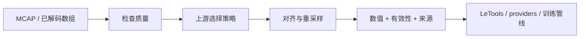
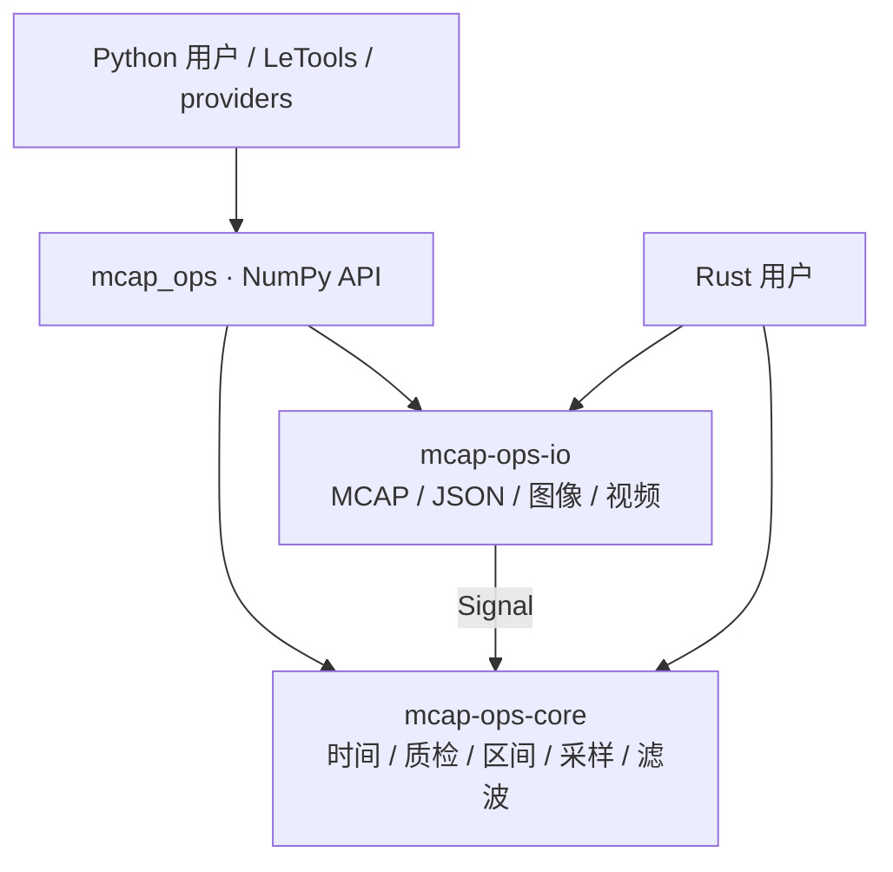

<p align="center">
  
</p>

<p align="center">
  <strong>让时间、质量与来源，成为数据的一部分。</strong><br>
  Rust 实现的 MCAP 与时序算子库 · NumPy 接口 · 可审计的性能优化
</p>

<p align="center">
  <a href="docs/getting-started.md">快速上手</a> ·
  <a href="docs/README.md">文档导航</a> ·
  <a href="docs/python.md">Python API</a> ·
  <a href="docs/architecture.md">架构设计</a> ·
  <a href="RSI/README.md">RSI 工作流</a>
</p>

## 从多路原始信号，到可学习的每个时间步

`mcap-ops` 为数据平台、providers、LeTools 和独立脚本提供可组合的处理能力：
检查录制质量、筛选时间区间、对齐多路时间轴、重采样数值与历史窗口，以及检查图像和视频。
数值核心不依赖 ROS、MCAP 文件、GPU 或某个机器人型号。

**算子负责计算和证据；上游负责数据含义、筛选政策与数据集写入。**



| 能力 | 你能得到什么 |
| --- | --- |
| 时间与同步 | 纳秒整数时间轴、缺口/倒退检查、因果匹配、显式时钟修正 |
| 信号质检 | 非有限值、越界、变化速率、加速度、尖峰与平线候选证据 |
| 筛选与采样 | 区间运算、质量门控、previous / nearest / linear / SLERP、历史窗口 |
| 滤波 | EMA、FIR、低通系数、角度展开；显式延迟与前视信息 |
| MCAP | 原始顺序读取、topic/时间过滤、现有 CRC 校验、JSON 字段解码 |
| 媒体 | PNG/JPEG 指标、裁剪缩放、FFmpeg 完整解码检查 |

完整能力和 Python/Rust 可用性见[算子清单](docs/operators.md)。

## 五分钟体验

当前版本为 **0.1.0**，尚未发布到 PyPI 或 crates.io。先在仓库根目录、已有
Rust 1.90 工具链的开发环境中构建；本项目维护者的全部构建和测试在 `reference-linux` 上执行。

```bash
python3 -m venv .venv
.venv/bin/python -m pip install "maturin>=1.9,<2" "numpy>=1.24"
.venv/bin/maturin develop --release --locked
.venv/bin/python examples/quickstart.py
```

```python
import numpy as np
import mcap_ops as ops

t = np.array([0, 10, 20], dtype=np.int64) * 1_000_000  # ns
x = np.array([[0.0], [1.0], [2.0]], dtype=np.float64)
target = np.asarray(ops.uniform_grid(0, 25_000_000, 200, 1, 100), dtype=np.int64)

result = ops.resample(
    t, x, target, method="linear",
    max_gap_ns=15_000_000, allow_future=True,
)
print(result["values"].ravel())  # [0.  0.5 1.  1.5 2. ]
print(result["valid"])          # [ True  True  True  True  True]
```

线性插值在相邻样本之间使用未来支撑点，所以这里显式允许 `allow_future=True`。
命令/模式等因果信号可使用 `previous`，并明确设置 `max_age_ns`。
安装、平台要求与 Rust 接入见[快速上手](docs/getting-started.md)。

## 三层实现，一份语义



- **检测不修复**：尖峰可能是有价值的接触事件，质检不会自动删掉它。
- **时间是契约**：`int64` 纳秒、明确时钟来源；不偷偷排序、去重或估计偏移。
- **缺失是结果**：超龄或缺少支撑时返回无效状态，不以零伪装观测。
- **结果可追溯**：重采样保留来源索引、插值权重和是否使用未来值。
- **含义留给上游**：单位、坐标系、关节顺序、action 标签由 provider 明确解释。

详见[设计与架构](docs/architecture.md)、[抽象与数据契约](docs/concepts.md)。

## 性能有证据

RSI 将探索落成循环：**profiling → 瓶颈假设 → 小改动 → 正确性 → 配对 benchmark → 接受或拒绝**。
每个接受的性能提交都记录方法、前后耗时与证据；失败补丁和反例同样保留。

最近一轮完成 **30 个实现单元 × 10 次 = 300 个决策：23 接受、277 拒绝**。
这不是 300 个公开 API，也不代表每个算子都变快。

| 最终对比中的代表用例 | 耗时降低 |
| --- | ---: |
| 随机输入 Hampel 质检 | 90.21% |
| 稀疏时间戳对齐 | 72.17% |
| 非连续 NumPy 重采样 | 68.75% |
| 混合 topic 的 MCAP 读取 | 23.86% |

这些是 reference-linux 上生成数据的特定用例，相对该轮开始状态的配对结果；
不能推断为真实数据管线或所有平台的加速倍数。
查看[完整结果与限制](docs/performance/per-op10/RESULTS.md)、
[失败经验](docs/performance/per-op10/LESSONS.md)和[可重复工作流](RSI/README.md)。

## 目录与阅读路线

```text
crates/core/       纯 Rust 数值核心
crates/io/         MCAP 与媒体适配
crates/python/     PyO3 / NumPy 绑定
python/mcap_ops/   Python 公共接口
examples/         可运行的 Python 示例
docs/             设计、API、接入指南与性能证据
RSI/              优化工作流、验收规则、实验模板
benchmarks/       生成数据、差分 oracle、历次候选
scripts/          校验、profiling、benchmark、Git 同步工具
```

想使用：[快速上手](docs/getting-started.md) → [多信号管线](docs/guides/pipeline.md) →
[Python API](docs/python.md)。
想扩展：[架构](docs/architecture.md) → [Rust API](docs/rust.md) →
[贡献与验证](docs/contributing.md)。
想优化：[RSI 导航](RSI/README.md) → [操作手册](RSI/workflow.md) →
[已有探索](RSI/evidence.md)。

## 当前边界

CDR/Protobuf 由上游提供解码适配；`gate`、`IntervalSet` 等部分底层接口仍为 Rust-only。
Python 输入会复制为拥有所有权的快照，当前绑定仍持有 GIL。
图像变换输出 PNG；视频检查不负责 MCAP 内视频包的时钟重建。
不包含 Web UI、数据集写入、Ego 感知、自动时钟拟合或 GPU 执行器。

已记录验证：36 项 Rust 测试、5 项 Python smoke 测试、291 项 Python 公共接口对比，
另有不可变参考实现的差分检查。已有 wheel 仅验证 Linux x86-64 / glibc 2.39+ /
CPython 3.12；abi3 最低接口版本为 Python 3.10。[验证记录](docs/performance/per-op10/final/verification.json)。

[MIT License](LICENSE)。目录中的第三方 Xpark 展示材料不属于本项目，也不随仓库分发。
