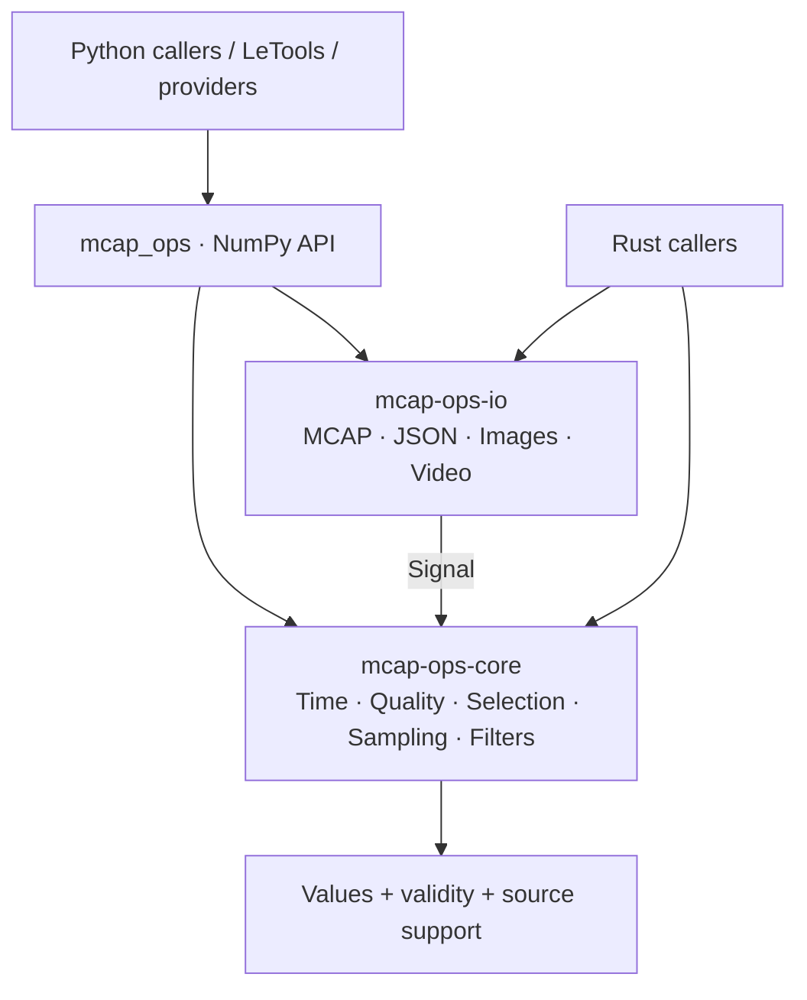

<p align="center">
  
</p>

<h1 align="center">MCAP Ops: High-Performance Signal Processing in Rust</h1>

<p align="center">
  Inspect recording quality, align sensor clocks, resample signals, and preserve their provenance.<br>
  A standalone Rust core with NumPy interfaces for data platforms, providers, and training pipelines.
</p>

<p align="center">
  <strong>Documentation:</strong>
  <a href="https://xieweikai.github.io/mcap-ops/">https://xieweikai.github.io/mcap-ops/</a>
</p>

<p align="center">
  
  
  
  <a href="RSI/README.md"></a>
  <a href="LICENSE"></a>
</p>

<p align="center">
  <a href="https://xieweikai.github.io/mcap-ops/tutorials/">Tutorials</a> ·
  <a href="https://xieweikai.github.io/mcap-ops/reference/">Documentation</a> ·
  <a href="https://xieweikai.github.io/mcap-ops/zh/">Chinese Documentation</a> ·
  <a href="https://xieweikai.github.io/mcap-ops/reference/rust/">Rust API</a> ·
  <a href="RSI/README.md">RSI Workflow</a>
</p>

`mcap-ops` is a Rust and Python library for quality inspection, temporal alignment,
resampling, interval selection, filtering, and media checks. It is designed to be
used independently or underneath tools such as [LeTools](https://github.com/XieWeikai/letools)
and source providers. The numeric core requires no ROS installation, GPU,
robot-specific schema, or dataset format.

- **Inspect before transforming.** Detect non-finite values, range violations,
  clock reversals, gaps, rate/acceleration anomalies, spikes, and flatline candidates.
- **Make time explicit.** Use integer nanoseconds, rational-rate grids, bounded
  sample age, and explicit past/future policies.
- **Keep the evidence.** Resampling returns validity, status, source indices,
  interpolation weights, and future-use flags alongside values.
- **Compose the right representation.** Choose previous, nearest, linear, or
  quaternion SLERP; retain high-frequency history windows when a single value is insufficient.
- **Bring your own semantics.** Providers own units, coordinate frames, clocks,
  schemas, and action meaning. The library does not guess them.
- **Optimize against evidence.** Keep profiling, paired benchmarks, correctness
  checks, accepted commits, and rejected experiments together.

## Quick Start

Version **0.1.0** is available from source. It has not been published to PyPI or
crates.io. With Rust 1.90 and Python 3.10+ available, run in the repository root:

```bash
git clone https://github.com/XieWeikai/mcap-ops.git
cd mcap-ops
python3 -m venv .venv
.venv/bin/python -m pip install "maturin>=1.9,<2" "numpy>=1.24"
.venv/bin/maturin develop --release --locked
.venv/bin/python examples/quickstart.py
```

Maintainers use a separate Linux execution environment for builds and tests; see
[installation and platform limits](docs/getting-started.md) and
[contributing](docs/contributing.md). The verified wheel targets Linux x86-64 /
glibc 2.39+, with CPython abi3 3.10+; execution was verified on CPython 3.12.

## Use MCAP Ops

Resample a 100 Hz signal onto a 200 Hz grid, keeping each output's support:

```python
import numpy as np
import mcap_ops as ops

t = np.array([0, 10, 20], dtype=np.int64) * 1_000_000  # nanoseconds
x = np.array([[0.0], [1.0], [2.0]], dtype=np.float64)
grid = np.asarray(ops.uniform_grid(0, 25_000_000, 200, 1, 100), dtype=np.int64)

report = ops.inspect_signal(t, x, {"max_gap_ns": 15_000_000})
result = ops.resample(
    t, x, grid, method="linear",
    max_gap_ns=15_000_000, allow_future=True,
)
print(result["values"].ravel())  # [0.  0.5 1.  1.5 2. ]
print(result["valid"])          # [ True  True  True  True  True]
```

Linear interpolation uses a future support sample between observations, so the
example explicitly permits it. For causal commands or modes, use `previous` with
an explicit `max_age_ns`. Unsupported samples remain invalid; they are not
silently zero-filled or interpolated across an excessive gap.

| Task | Interfaces | Guide |
| --- | --- | --- |
| Inspect signals and recordings | `inspect_signal`, `inspect_mcap` | [Python API](docs/python.md) |
| Match clocks and construct grids | `align_timestamps`, `uniform_grid` | [Time and validity](docs/concepts.md) |
| Prepare model inputs | `resample`, `history_windows` | [Multi-signal pipeline](docs/guides/pipeline.md) |
| Filter and unwrap | `ema`, `fir`, `lowpass_taps`, `unwrap_angles` | [Operator catalog](docs/operators.md) |
| Decode and inspect media | `read_json_signal`, `image_quality`, `transform_image`, `validate_video` | [MCAP and media](docs/guides/media.md) |
| Apply quality gates and interval selection | Rust `gate`, `IntervalSet` | [Rust API](docs/rust.md) |

The complete [Python reference](docs/python.md) documents all 14 exported
processing functions, actual return types, shapes, error behavior, and defaults.
Rust callers can depend on `mcap-ops-core` without pulling in the IO layer.

## Architecture

Python supplies a thin NumPy boundary over the same Rust implementation. The IO
crate handles containers and media; the core handles arrays and time. Detection,
selection, and transformation remain separate operations.



The [architecture reference](docs/architecture.md) explains ownership, module
boundaries, the `SignalDecoder` extension point, and upstream responsibilities.
The [data contracts](docs/concepts.md) define clocks, units, causality, gaps,
status codes, shapes, and provenance.

## Performance

The most recent campaign evaluated **10 candidates for each of 30 implementation
units: 300 decisions, 23 accepted and 277 rejected**. Earlier campaigns add 80
preserved decisions. These are optimization experiments, not additional APIs.

| Representative final workload | Latency reduction |
| --- | ---: |
| Random-input Hampel inspection | **90.21%** |
| Sparse timestamp alignment | **72.17%** |
| Strided NumPy resampling | **68.75%** |
| Mixed-topic MCAP reading | **23.86%** |

These results compare with the start of that campaign, on generated fixtures on
a single pinned CPU in the reference Linux environment. They do not imply the same gains for real recordings, complete
pipelines, other input distributions, or other machines. Read the
[measurement guide](docs/performance.md) and
[full results, raw samples, and limitations](docs/performance/per-op10/RESULTS.md).

## Reproducible Optimization

The [RSI workflow](RSI/README.md) documents the full loop:
**profile → identify a bottleneck → make one change → verify correctness → benchmark → decide**.
Acceptance requires at least 8% aggregate latency reduction in every paired
block, no representative-case median regression above 3%, and passing correctness,
resource, and complexity checks. Every accepted candidate has its own commit;
failed patches and counterexamples remain available.

The complete playbook and experiment templates are available in
[English](RSI/README.md) and [Chinese](RSI/zh/README.md).

## Documentation

The [documentation website](https://xieweikai.github.io/mcap-ops/) provides
English/Chinese search, a progressive tutorial path, individual operator pages,
types and abstractions, generated Rust API docs, and the RSI playbook.
Start with [Tutorials](https://xieweikai.github.io/mcap-ops/tutorials/) to learn
the library, or [Documentation](https://xieweikai.github.io/mcap-ops/reference/)
to look up a signature, parameter, return value, or example.

| Read about | English | Chinese |
| --- | --- | --- |
| Installation and examples | [Getting started](docs/getting-started.md) | [Chinese guide](docs/zh/getting-started.md) |
| Design and abstractions | [Architecture](docs/architecture.md) | [Chinese guide](docs/zh/architecture.md) |
| Types, clocks, and validity | [Data contracts](docs/concepts.md) | [Chinese guide](docs/zh/concepts.md) |
| Public interfaces | [Python](docs/python.md) / [Rust](docs/rust.md) | [Python](docs/zh/python.md) / [Rust](docs/zh/rust.md) |
| Profiling and acceptance | [RSI playbook](RSI/README.md) | [Chinese playbook](RSI/zh/README.md) |
| All guides | [Documentation index](docs/README.md) | [Chinese index](docs/zh/README.md) |

## Current Boundaries

The built-in numeric decoder handles JSON; CDR/Protobuf and MCAP video packet
mapping belong in upstream adapters. Some lower-level interfaces are Rust-only.
Python inputs are copied into owned snapshots, and bindings currently hold the
GIL. There is no dataset writer, web UI, automatic clock fitting, GPU executor,
or Ego perception pipeline.

The historical release passed 36 Rust tests, five Python API smoke tests, 291
public-interface comparisons, and an immutable-reference oracle. See the
[release verification record](docs/performance/per-op10/final/verification.json).
Later workflow tests are documented separately; historical test counts are not
silently relabeled as new measurements.

[MIT License](LICENSE). Third-party Xpark showcase material is excluded from this
repository and its distribution.
