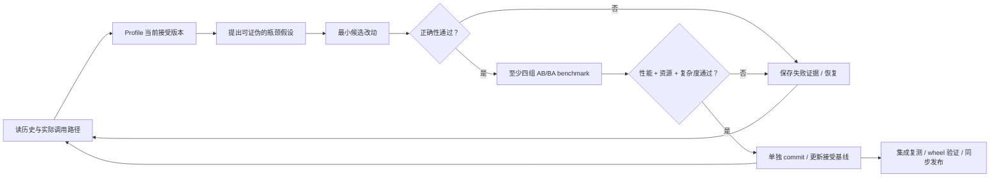

# RSI：有证据的迭代优化

[项目首页](../README.md) · [文档导航](../docs/README.md)

这里将本仓库采用的 RSI 方法落成版本化的操作手册、命令入口、验收规则和实验模板。
执行工具复用 `scripts/`，证据继续放在 `docs/performance/`，不复制一套 runner，
也不依赖某个聊天工具或 skill 系统。

## 入口

| 文档 | 内容 |
| --- | --- |
| [workflow.md](workflow.md) | 从准备、探索、baseline 到单轮决策、commit 和最终交付的完整步骤 |
| [profiling.md](profiling.md) | 各层测什么、Callgrind/cProfile 命令、计时方法、噪声与复测 |
| [correctness.md](correctness.md) | 公共接口、不可变参考、边界用例、资源与复杂度门槛 |
| [evidence.md](evidence.md) | 380 次历史决策、成功/失败经验、证据布局、脚本职责 |
| [campaign 模板](templates/campaign.md) | 新一批探索开始前冻结目标、环境、工作负载和预算 |
| [experiment 模板](templates/experiment.md) | 单候选的假设、改动、前后数据、验证、决定、后续经验 |

## 不变的接受标准

- 至少 **4 组交替 AB/BA**，每侧 **7 个校准样本**，同主机/CPU/工具链/编译参数/fixture。
- 每一组固定用例集合的几何平均**耗时降低至少 8%**。
- 任一代表用例的配对中位数耗时退化不超过 **3%**；不能用大收益掩盖别的常用路径。
- 正确性、错误行为、时钟、来源、shape、输入所有权和资源限制保持；改动复杂度可接受。
- PNG 编码候选还须解码像素完全一致，测得的最大输出大小增长不超过 **1.25×**。
- 每个接受候选单独 commit，提交内包含方法、前后 ns/op、最差块、正确性与证据路径。

“开始运行”“编译通过”和“有一个更快的样本”都不是完成实验。未通过的改动不留在生产
路径，失败经验照样入库；编译修复或中断重启不充当额外优化轮数。

## 执行位置

本地 authoring checkout 编辑代码、记录决策和提交；reference-linux 使用项目本地工具构建、测试、
profile 和计时。benchmark 在 CPU 12 串行运行，不能并发多个试验抢同一 CPU。
不读取无关录制、不改全局性能计数器权限、不控制机器人服务。

新 campaign 使用新 `--series` 和全局唯一 label。历史 `initial` / `extension` / `per-op10`
保留不动。命名后的手工流程可直接使用现有 trial/decide/archive CLI；固定 300 轮的
自动 runner 只用于原 campaign，不是通用参数扫描器。
