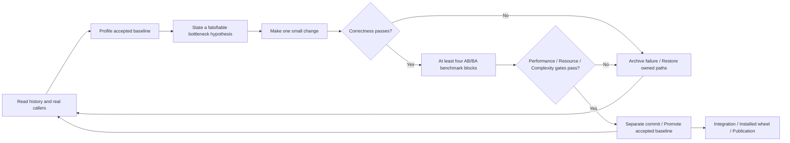

# RSI: Evidence-Driven Iterative Optimization

**Language: English | [Chinese](zh/README.md)**

[Project overview](../README.md) · [Documentation](../docs/README.md)

This directory turns the repository's RSI method into versioned runbooks,
command entry points, acceptance rules, and experiment templates. Execution
reuses scripts/; evidence stays under docs/performance/. There is no duplicate
runner or dependency on a particular assistant or skill system.

## Playbook

| Document | Contents |
| --- | --- |
| [workflow.md](workflow.md) | Preparation, exploration, baseline, trial, decision, commit, delivery |
| [profiling.md](profiling.md) | What to profile, Callgrind/cProfile, timing, noise, confirmations |
| [correctness.md](correctness.md) | Public contracts, immutable oracle, boundary cases, resource/complexity gates |
| [evidence.md](evidence.md) | All 380 decisions, successful and failed ideas, archive layout, script roles |
| [Campaign template](templates/campaign.md) | Freeze scope, environment, workloads, and budget before exploration |
| [Experiment template](templates/experiment.md) | Hypothesis, change, measurements, checks, decision, lesson |

Every page and template has a matching Chinese version. Measurements and patches
are shared evidence rather than language-specific copies.

## Acceptance rules

- At least four alternating AB/BA blocks, seven calibrated samples per side,
  with the same environment, CPU affinity, toolchain, flags, and fixtures.
- Every block's geometric-mean latency reduction over the frozen case set is at least 8%.
- No representative case's paired median regresses by more than 3%.
- Correctness, errors, clocks, provenance, shapes, ownership, and limits remain intact;
  the added complexity must be justified.
- PNG encoder candidates preserve decoded pixels and keep the largest measured
  output-size ratio at or below 1.25x.
- Each accepted candidate gets a separate commit recording the method,
  before/after ns/op, worst block, correctness, and evidence paths.

Starting a process, compiling, or observing one fast sample does not complete an
experiment. Rejected code does not remain in production; its evidence does.
Compilation repairs and interrupted retries do not count as extra optimization rounds.

## Execution environment

Author, review, decide, and commit locally. Build, test, profile, and time in a
separately configured Linux x86-64 checkout with project-local tools. The
[reference environment](../docs/performance.md) records hardware and software,
not a deployment address. Keep target coordinates in ignored configuration.
Benchmark trials run serially with fixed CPU affinity, without touching unrelated
recordings, system profiler permissions, or robotics services.

Use a new series and globally unique label for a new campaign. Preserve initial,
extension, and per-op10. The manual trial/decide/archive workflow supports new
namespaces; the historical fixed-count runners are not general campaign engines.
