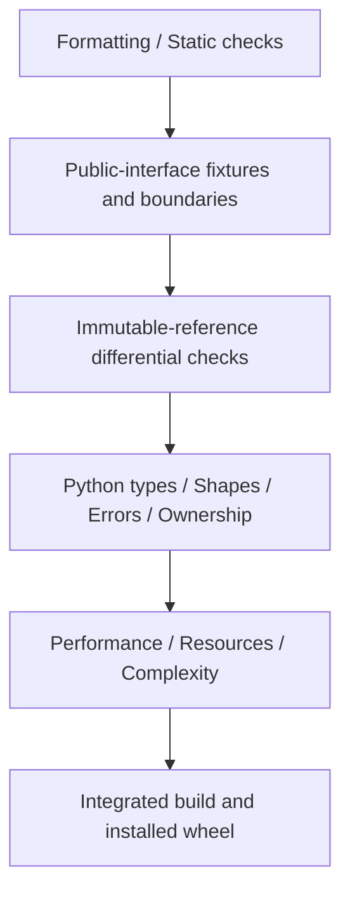

# Correctness, Resources, and Complexity

**Language: English | [Chinese](zh/correctness.md)**

[Overview](README.md) · [Workflow](workflow.md)

## Validation layers



Test public behavior rather than mirroring a private implementation loop.
Benchmarks must consume successful results. An Err path, omitted records, or
missing output is not a speedup.

## Boundary matrix

| Category | Minimum coverage |
| --- | --- |
| Time | Empty/singleton, duplicates/reversals, int64 extremes, epoch precision, rational rate, overflow |
| Sampling | Exact endpoints, excessive gaps, age, missing supports, nearest ties, prohibited future, indices/alpha |
| Multichannel | 1-D/2-D, empty rows, zero-channel errors, mismatched counts, row invalidation by NaN/Inf |
| Quaternions | xyzw, q/-q, near-collinear, norm boundary, non-finite values, wrong dimension |
| History | Overlap/separation, nonpositive offsets, ordering, addition overflow, flat provenance correspondence |
| Quality | Threshold edges, zero MAD, window caps, spikes/flatlines, detail truncation with full statistics |
| Intervals | Half-open edges, empty sets, adjacent merge, disorder, dense/sparse set operations, expansion overflow |
| Filters | Causal/centered, short/long taps, insufficient support, outage reset, non-finite values, extreme coefficients, delay metadata |
| MCAP | Real writer/reader fixtures, write order, corruption/missing CRC, unknown encoding, limits, source changes |
| Media | Actual PNG/JPEG, pixels/dimensions/limits, tiny edges, complete/corrupt video, timeout, tool failure |

Use generated fixtures. Never clean up unrelated recordings or interfere with
robotics services to validate the library.

## Immutable oracle and numeric rules

The reference implementation is commit
`66248dacb608859d2cbd0f9f27227c65013a8027`.
prepare_reference.py materializes it into an isolated workspace and refuses
changed reference sources. Full history is required; a missing reference commit
is not a passing differential check.

- Timestamps, indices, masks, statuses, counts, and discrete values match exactly.
- Rust finite-value tolerance is `abs(new-old) <= 1e-10 * (1 + abs(old))`.
- Python uses `rtol=1e-10, atol=1e-10, equal_nan=True`, checking dtype/shape/container types.
- Preserve observable NaN/Inf behavior; do not compare integers through lossy floats.
- Diagnostics, exception types/messages, dictionary order, input immutability,
  and lack of output/input aliases are part of the interface.
- Encoded image bytes may differ, but decoded dimensions/pixels must agree;
  image metrics use the declared numeric tolerance.

If an operator needs a different tolerance, justify and review it before looking
at failed results. The oracle is not mathematical truth: fix discovered baseline
bugs separately, rather than changing semantics and removing failing checks
inside a supposedly equivalent optimization.

## Execute checks

At the configured execution checkout root, with project-local tool paths active:

```bash
cargo fmt --all --check
cargo clippy --workspace --all-targets --locked -- -D warnings
cargo test --workspace --locked -j 12
python3 scripts/prepare_reference.py
CARGO_PROFILE_RELEASE_DEBUG=0 CARGO_TARGET_DIR="$PWD/target/reference" \
  cargo run --offline --release --manifest-path .artifacts/rsi/validation/Cargo.toml -j 12
.venv/bin/maturin develop --release --locked
.venv/bin/python -m pytest -q tests
```

Offline execution requires cached dependencies. A missing cache is an environment
preparation failure, not a successful oracle run. Bridge changes additionally need:

```bash
.venv/bin/python scripts/check_python_equivalence.py \
  --before .artifacts/rsi/python/accepted \
  --after .artifacts/rsi/python/CANDIDATE_LABEL
```

## Resource and maintenance gates

| Concern | Required evidence |
| --- | --- |
| Temporary storage | Peak bytes or a clear bound, such as another 8*N*D bytes for transposition |
| Caches | Capacity, complete key, invalidation, empty/singleton overhead |
| Encoding | Exact decoded pixels, size pairs per fixture, maximum ratio <=1.25 |
| Complexity | Production diff, new branches/helpers, duplicated algorithms, edge-case burden |
| Dependencies/unsafe/approximation | Not an implicit tradeoff; require separate design and review |

PNG candidates enable --png-size-gate, which consumes oracle resource_png records.
The size bound covers tested fixtures, not all future images. There is no universal
automatic RSS gate: record analysis or measurement instead of claiming unmeasured
cost is zero.

Line count alone is insufficient. A cryptic one-liner can cost more to maintain
than a clear loop. Retain changes only when stable gains, applicable distributions,
and maintenance cost are understood.

## Final artifact gate

Individually passing changes can regress in an integrated binary. Rebuild the
campaign baseline and final source with the same final harness and run all
representative workloads. Compare real release wheels, install into an isolated
environment, and retain wheel/extension/source SHA-256 identities.

The historical [verification record](../docs/performance/per-op10/final/verification.json)
contains 36 Rust tests, five Python smoke tests, 291 interface comparisons, and
the reference oracle. Later tests change current counts; report actual executions
rather than repeating historical counts as if newly measured.
