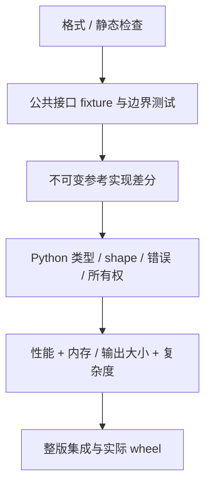

# 正确性、资源与复杂度验收

[导航](README.md) · [操作手册](workflow.md)

## 验收层次



测试从公共接口验证行为，不为某个私有循环写同构测试。基准必须消费成功结果，
不能把 Err、少处理数据或省略输出当作优化。

## 核心边界矩阵

| 类别 | 至少覆盖 |
| --- | --- |
| 时间 | 空/单样本、重复、倒退、int64 边界、epoch 精度、有理频率、整数溢出 |
| 采样 | 精确端点、超限 gap、超龄、缺前/缺后、nearest 平局、未来禁止、源索引/alpha |
| 多通道 | 一维/二维、空行、零通道错误、通道不匹配、某一通道 NaN/Inf 使整行失效 |
| 四元数 | xyzw、q 与 -q、近共线、模长边界、非有限值、错误通道数 |
| 历史窗口 | 重叠/非重叠、非正 offsets、严格顺序、时间加法溢出、平坦 provenance 对应关系 |
| 质检 | 阈值相等/越界、MAD=0、窗口上限、尖峰/平线、issues 截断仍保留总统计 |
| 区间 | 半开端点、空集合、相邻合并、乱序、稠密/稀疏交差、上下文扩展溢出 |
| 滤波 | 因果/centered、短/长核、缺失支撑、断点重置、非有限、系数极端值、延迟元数据 |
| MCAP | 真实 writer/reader fixture、文件写入顺序、CRC 损坏、缺 CRC、未知编码、限额、源变化 |
| 图像/视频 | 实际 PNG/JPEG、像素/尺寸、限额、图像边界、完整视频/坏输入/超时/工具错误 |

输入均为生成 fixture。不能触碰无关录制、自动“清理”真实数据或干扰机器人服务。

## 不可变 oracle 与浮点规则

参考源提交为 `66248dacb608859d2cbd0f9f27227c65013a8027`；
`prepare_reference.py` 从 Git 提取并建立独立 workspace，拒绝覆盖发生变化的参考源。
需要完整历史，浅克隆缺少参考 commit 时不能声称通过 differential。

- 时间、索引、mask、status、数量、离散输出必须完全相等。
- Rust oracle 对有限值用 `abs(new-old) <= 1e-10 * (1 + abs(old))`。
- Python 对比使用 `rtol=1e-10, atol=1e-10, equal_nan=True`，并检查 dtype/shape/容器类型。
- NaN/Inf 的可观察行为保持；整数不能借浮点比较而丢失精度。
- 诊断内容、异常类型与消息、字典迭代顺序、输入不被修改和输出不别名输入都属于契约。
- 图像编码可能产生不同压缩字节，但解码尺寸和像素要一致；质量指标按现有容差比较。

不同算子若确需不同容差，先解释数值误差来源并单独审阅，不在失败后随手放宽。
oracle 也不是数学真理；若发现原实现缺陷，应作为独立正确性修复，不能一边改语义一边
把旧 oracle 删除后称性能优化等价。

## 直接执行

以下在 reference-linux 仓库根目录，先按贡献指南激活项目工具路径：

```bash
cargo fmt --all --check
cargo clippy --workspace --all-targets --locked -- -D warnings
cargo test --workspace --locked -j 12
python3 scripts/prepare_reference.py
CARGO_PROFILE_RELEASE_DEBUG=0 CARGO_TARGET_DIR="$PWD/target/reference" \
  cargo run --offline --release --manifest-path .artifacts/rsi/validation/Cargo.toml -j 12
.venv/bin/maturin develop --release --locked
.venv/bin/python -m pytest -q tests
```

`--offline` 需要已有依赖缓存；缓存缺失属于环境准备失败，不是 oracle 通过。
Python bridge 变更还要比较前后快照：

```bash
.venv/bin/python scripts/check_python_equivalence.py \
  --before .artifacts/rsi/python/accepted \
  --after .artifacts/rsi/python/CANDIDATE_LABEL
```

## 资源和复杂度也是门槛

| 问题 | 要记录的证据 |
| --- | --- |
| 新临时缓冲 | 峰值字节数或明确公式；例如转置需要额外 `8*N*D` 字节 |
| 缓存 | 容量、键完整性、失效条件、空/单项数据时的开销 |
| 编码参数 | 精确解码像素、每个 fixture 的 before/after 大小，最大比值 <=1.25 |
| 代码增长 | 生产 diff、额外分支/辅助函数、是否复制算法、边界负担 |
| 新依赖/unsafe/近似 | 不能作为当前协议内的偷换；需要单独设计与审查 |

PNG 候选通过 `rsi_trial.py --png-size-gate` 自动读取 oracle 的 resource_png 证据。
这只覆盖被测 fixture，不是所有未来图像的大小保证。没有通用自动 RSS gate；内存分析
和必要的测量应写入实验记录，不能把未测量说成零成本。

代码行数不是唯一标准：一行复杂位运算可能比几行清楚的循环更难维护。只有性能收益
稳定、适用分布明确且维护成本可接受，才保留生产变更。

## 最终产物门槛

逐轮通过后，完整版本可能因代码布局和路径组合出现退化。必须以最终同一 harness
重建 campaign 初始源与当前源，覆盖全部代表用例。对比真实 release wheel，安装到独立
环境再检查公共接口，并保存 wheel、扩展、源文件的 SHA-256。

历史最终验证见 [verification.json](../docs/performance/per-op10/final/verification.json)：
36 Rust tests、5 Python smoke tests、291 public-interface comparisons 及 reference oracle。
这是当时的记录，后续新增测试会改变计数；报告当前实际执行的数量，不机械复制旧数字。
