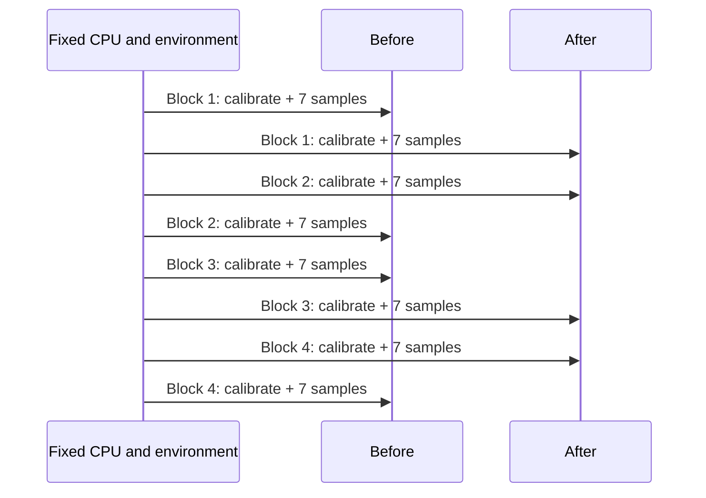

# Profiling and Benchmarking

**Language: English | [Chinese](zh/profiling.md)**

[Overview](README.md) · [Workflow](workflow.md)

## Attribute cost before choosing a technique

| Layer / operator | Costs to separate | Representative inputs |
| --- | --- | --- |
| Python bridge | Snapshot, strided copy, JSON, output creation/destruction | Small/large arrays, contiguous/strided/reversed values, errors |
| Time/sampling | Scans, irrelevant prefixes, searches, channel loops | Dense/sparse targets, exact/off-grid, gaps, all methods |
| Hampel/quality | Sorting, MAD, window maintenance, disabled checks | Random/smooth/repeated values, short/wide windows, NaN, outages |
| FIR/EMA | Support checks, coefficients, repeated dt, accumulation, scratch space | Short/long kernels, scalar/vector, irregular dt, invalid data |
| Intervals | Merge, prefix lookup, set operations, masks | Empty/singleton, sorted/shuffled, dense/late intersections |
| MCAP | Read, decompress, CRC, topic matching, payload decode | No/single/multiple topics, linear/chunked, corruption/limits |
| Images | Decode, luminance, stencils, encoding, output size | PNG/JPEG, gradients/noise, large and tiny images |
| Video | Process startup, probe, decode, waiting/diagnostics | Short/long videos, corruption, timeout, no frames |

Keep inclusive function cost, Python overhead, and numeric-kernel time distinct.
Callgrind supplies instruction/call-path evidence; cProfile attributes Python
cost. Instrumented durations are never formal wall-clock benchmark results.

## Native profiles: Callgrind

The [reference environment](../docs/performance.md) restricted hardware counters
with perf_event_paranoid=4, so it used project-local Valgrind without changing
system permissions. Recheck capabilities in another environment.

Run at the execution checkout root:

```bash
mkdir -p .artifacts/rsi/explore
VALGRIND_LIB="$PWD/.tools/valgrind/root/usr/libexec/valgrind" \
  .tools/valgrind/root/usr/bin/valgrind \
  --tool=callgrind --collect-atstart=no \
  --toggle-collect='operator_benchmark::Runner::bench*' \
  --callgrind-out-file=.artifacts/rsi/explore/before.callgrind \
  .artifacts/rsi/bin/accepted --case inspect_signal.hampel --profile
.tools/valgrind/root/usr/bin/callgrind_annotate \
  --auto=no --inclusive=yes --threshold=98 \
  .artifacts/rsi/explore/before.callgrind
```

Confirm symbols, collection scope, and nonzero instruction counts. Profile the
operation, not just fixture construction or file preparation. Do not quote
Valgrind runtime as an optimization gain.

## Python profiles: cProfile

```bash
PYTHONPATH="$PWD/.artifacts/rsi/python/accepted" \
RSI_PYTHON_ROOT="$PWD/.artifacts/rsi/python/accepted" \
  .venv/bin/python scripts/python_benchmark.py \
  --case python.resample.strided --profile .artifacts/rsi/explore/before.prof
.venv/bin/python -c 'import pstats; pstats.Stats(".artifacts/rsi/explore/before.prof").strip_dirs().sort_stats("cumulative").print_stats(25)'
```

RSI_PYTHON_ROOT verifies actual import location to prevent timing the wrong
installed extension. Benchmark fixtures additionally need Pillow and Python
mcap; these are not package runtime dependencies. Profiling multiple cases writes
separate per-case files.

## Paired wall-clock timing

```bash
python3 scripts/rsi_measure.py \
  --before .artifacts/rsi/bin/accepted \
  --after .artifacts/rsi/bin/CANDIDATE_LABEL \
  --cases align_timestamps.previous,align_timestamps.nearest \
  --cpu 12 --blocks 4 --samples 7 --millis 20 \
  --output .artifacts/rsi/explore/measurement.json
```

Replace the label with the real candidate and choose CPU affinity from the target
topology. Python before/after arguments are package-snapshot directories. The
low-level measurement tool permits two exploratory blocks, but acceptance needs
at least four; trial enforces that minimum. The default target is 20 ms per
sample, with calibrated iteration counts; a slow operation may already exceed it.



Generate fixtures outside timing. Black-box or consume inputs/outputs and require
success. Include allocation, conversion, preparation, and output destruction
needed by each public call; do not move transposition or copying outside timing.
Video includes subprocess startup. Repeated file IO is usually warm-cache work,
not a cold-storage bandwidth benchmark.

## Acceptance arithmetic

For block b and case c, let r be the ratio of after/before sample medians:

```text
r[b,c] = median(after samples) / median(before samples)
g[b] = exp(mean_c(log(r[b,c])))
block reduction   = 100 * (1 - g[b])
reported aggregate = 100 * (1 - median_b(g[b]))
case reduction    = 100 * (1 - median_b(r[b,c]))
```

Every block must clear 8%; every case must stay above -3%; correctness/resources/
complexity must also pass. Displayed before_ns/after_ns are separate cross-block
medians, whose ratio need not equal the paired statistic. An 8% latency reduction
is not an 8% throughput increase or a requirement that every individual case gain 8%.

## Noise, counterexamples, and confirmation

Record CPU model/topology/affinity, OS, build flags, tool versions, binary hashes,
and an opaque run ID. Reestablish comparability after restart or upgrades.
Check competing load, frequency/thermal changes, and cache state without changing
global settings or interrupting unrelated jobs for a better score.

A predeclared independent confirmation can investigate unstable or near-boundary
results. Preserve the original observation; failed confirmation means rejection.
When counterexamples expand the fixture set, rebuild both sides with that harness
and explain why the earlier gate was insufficient. Never hide unstable results
or repeat indefinitely until one passes.

References: [Callgrind manual](https://valgrind.org/docs/manual/cl-manual.html),
[Python profiling](https://docs.python.org/3/library/profile.html). These explain
the tools; this repository defines its own acceptance thresholds.
