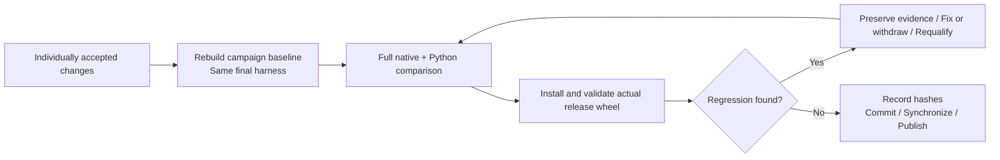

# RSI Workflow

**Language: English | [Chinese](zh/workflow.md)**

[Overview](README.md) · [Profiling](profiling.md) · [Correctness](correctness.md) · [Evidence](evidence.md)

## 0. Verify environment and ownership

Configure the execution target as described in [contributing](../docs/contributing.md).
Check the local checkout, then independently inspect HEAD and worktree state in
the execution checkout:

```bash
git status --short
git log -1 --oneline
```

Both baselines must agree. Investigate unknown edits and running candidates.
Validate real process identity rather than killing a PID copied from an old
lock file. The historical per-operator runner has an advisory lock, but manual
trials do not provide a global scheduler: never run two trials against the same
accepted cache concurrently.

Source synchronization and Git publication are different steps. sync_sources.py
transfers files without advancing remote HEAD. publish_remote.py verifies hashes
and fast-forwards history. Inspect dirty state before synchronizing; matching
HEADs do not prove matching files. Synchronization neither copies .git nor deletes
remote files, but it updates same-name sources.

## 1. Freeze the campaign

Read [past successes, failures, and counterexamples](evidence.md). Create a new
series, for example next-20261027, and copy the
[campaign template](templates/campaign.md) to its PLAN.md. That example name does
not mean the campaign has already run. Record:

1. Baseline commit/tree, toolchain, lockfile, CPU topology/affinity, OS, and an
   opaque run identifier, not a deployment name or private session identifier.
2. Operators, real callers, output contracts, sizes, and input distributions.
3. Frozen cases, timing boundaries, resource budgets, and correctness tolerances.
4. Experiment budget/stop conditions, complexity constraints, and a predeclared
   single independent-confirmation rule if needed.

Add missing fixtures and regression guards before candidates, in a separate
scaffolding commit. Both sides must use the same harness. The immutable
correctness oracle and the latest accepted performance baseline have different
roles; do not confuse them.

## 2. Build the accepted baseline

From the clean authoring checkout:

```bash
python3 scripts/sync_sources.py
```

Run the following in the configured Linux execution checkout. It assumes the
project-local toolchain and environment have been installed:

```bash
export CARGO_HOME="$PWD/.tools/cargo"
export RUSTUP_HOME="$PWD/.tools/rustup"
export PATH="$CARGO_HOME/bin:$PATH"
export VIRTUAL_ENV="$PWD/.venv"
export CARGO_PROFILE_RELEASE_DEBUG=1
export CARGO_BUILD_JOBS=12
cargo build --locked --release -p mcap-ops-io --example operator_benchmark
.venv/bin/maturin develop --release --locked
mkdir -p .artifacts/rsi/bin .artifacts/rsi/python/accepted/mcap_ops
cp target/release/examples/operator_benchmark .artifacts/rsi/bin/accepted
cp python/mcap_ops/__init__.py python/mcap_ops/_native.abi3.so .artifacts/rsi/python/accepted/mcap_ops/
```

accepted is a mutable working cache, not permanent evidence. Check that it matches
the planned baseline before changing sources. Record its commit, tool versions,
and binary SHA-256 and keep an immutable copy. A stale accepted binary does not
become the current baseline just because its filename exists.

## 3. Explore and profile

Follow the public call path through wrapper, bindings, core/IO, and output
construction. Quantify the cost before proposing a change. “Repeated sorting
costs 30%, while adjacent windows only move one sample” is a falsifiable hypothesis;
“a for loop should be faster” is not sufficient evidence.

Fill the [experiment template](templates/experiment.md). Which prior failure
used the same distribution? Which cases should win or lose? Is the cache key
complete? How much temporary memory is added? Does the candidate add traversal,
preparation, branches, copying, or ownership coupling?

Use [profiling commands](profiling.md). Short exploratory timings are allowed,
but cannot pass acceptance. Label parameter sweeps as such. Repeating a patch's
measurement does not create another algorithm.

## 4. Make one local change

Declare owned paths and ensure they contain no unrelated changes before editing.
Do not change compiler settings, dependency versions, fixtures, and production
algorithms in the same experiment. Never reduce validation, CRC coverage, samples,
output fields, or precision to claim speed.

Add new files/interfaces in a separate scaffold commit first. The trial snapshots
`git show HEAD:path`, so its owned paths must already be tracked.

## 5. Validate, profile, and measure

Run locally; the CLI dispatches compilation, tests, profiling, and timing to the
configured execution environment:

```bash
python3 scripts/rsi_trial.py next-align-01 \
  --series next-20261027 \
  --cases align_timestamps.previous,align_timestamps.nearest \
  --paths crates/core/src/time.rs
```

The case list illustrates command syntax. Freeze all representative cases,
including sparse targets where appropriate. Python candidates add --python and
python.* cases. PNG encoder candidates add --png-size-gate. Use --blocks 8 only
for a predeclared confirmation; ordinary acceptance requires at least four.

The trial saves baseline files/patch, synchronizes, profiles the baseline, runs
fmt/Clippy/Rust tests, checks the immutable oracle, builds the Python extension,
runs Python tests, profiles the candidate, measures AB/BA, and writes an audit.
Python trials additionally compare public interfaces. Formatting results return
only for owned paths; concurrent local source edits prevent overwrite.

A failed command does not create a valid measured decision. Read validation.log.
Use --retry for interrupted or compile-repair attempts without a decision;
previous logs survive in attempts/. Completed labels cannot be reused. Independent
confirmation uses a new label and retains the original result. Do not keep
rerunning until a favorable number appears.

## 6. Review more than the machine gate

Inspect measurement.json, audit.json, validation.log, profiles, candidate.patch,
and before/ under `.artifacts/rsi/trials/<label>/`:

- Computation succeeded, case sets match, and each side has enough samples.
- Every aggregate block clears 8%; each case's paired median stays above -3%.
- Complexity, memory, and output size are acceptable without semantic changes.
- Profiling explains reduced work rather than an unexplained layout/noise effect.
- Tests cover touched public behavior; floating-point tolerances were chosen beforehand.

performance_gate is a numeric gate, not complete approval. A human or agent still
reviews the diff, correctness scope, hotspot explanation, and maintenance cost.

## 7. Accept or reject

Write a factual decision, replacing the explanatory placeholders:

```bash
python3 scripts/rsi_decide.py next-align-01 \
  --series next-20261027 --operator align_timestamps --round 1 \
  --method 'Describe the actual implementation change' \
  --hotspot 'Describe the measured baseline hotspot' \
  --complexity 'Describe new branches, memory and maintenance cost' \
  --reason 'Describe why all gates passed' --accept
```

For rejection, omit --accept and explain why. Acceptance writes results/data and
a commit-message file but does not commit. Rejection archives the patch and
restores owned paths. The decision tool checks current HEAD, patch, series, and
baseline snapshot; changed work or an existing decision fails closed.

Stage only this candidate and its evidence, review, then commit:

```bash
git add crates/core/src/time.rs \
  docs/performance/next-20261027/results/next-align-01.json \
  docs/performance/next-20261027/data/next-align-01.json
git diff --cached --stat
git commit -F .artifacts/rsi/trials/next-align-01/commit-message.txt
```

After acceptance, promote the validated candidate in the execution checkout,
only after confirming that both source trees still match that candidate:

```bash
cp .artifacts/rsi/bin/next-align-01 .artifacts/rsi/bin/accepted
cp python/mcap_ops/__init__.py python/mcap_ops/_native.abi3.so .artifacts/rsi/python/accepted/mcap_ops/
```

Do not promote rejected binaries. Synchronize restored source before the next
trial. Rejected records may be committed separately as documentation, never as
successful performance changes.

## 8. Archive and integrate

Once the full trial is available locally:

```bash
python3 scripts/archive_extension_evidence.py --series next-20261027
```

This preserves validation text, profile summaries, hashes, and relative artifact
locations, not huge raw profiles. Write the new series' results and lessons from
its records. Historical report scripts have fixed baselines/counts; they are not
new-campaign completion generators.



Repeat formatting, Clippy, public tests, oracle, full comparison, and installed-wheel
checks. Profiling binaries and final wheels can use different debug settings;
both timed sides must match. Time the extension actually delivered, retaining
source/binary/wheel SHA-256.

The historical verification shell scripts target fixed campaigns and write their
reports. New campaigns reuse the checks with new baseline/output paths, not old
report destinations. Keep isolated acceptance and final delivery claims separate.

With clean commits, run publish_remote.py to verify file hashes and fast-forward
history, then push normally. Stop for divergent history or unexpected edits;
never force through them. Avoid endless retesting without changed evidence.
