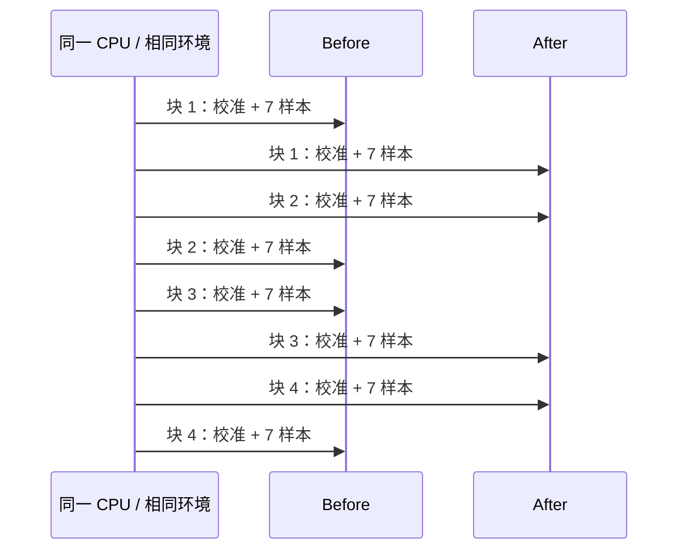

# Profiling 与 benchmark

**语言：中文 | [English](../profiling.md)**

[导航](README.md) · [操作手册](workflow.md)

## 按层定位，不先猜优化手段

| 层 / 算子 | 要分辨的成本 | 必须保留的代表输入 |
| --- | --- | --- |
| Python bridge | 输入快照、跨步拷贝、JSON、输出构造、释放 | 小/大数组、连续/跨步/反向 values、错误类型 |
| 时间/采样 | 源扫描、初始前缀、索引搜索、通道循环 | 密集/稀疏 target、精确/非网格点、缺口、四方法 |
| Hampel/质检 | 排序、MAD、窗口维护、禁用检查的开销 | 随机/平滑/重复值、短/宽窗口、NaN、断点 |
| FIR/EMA | 支撑检查、系数、dt 重复、累加、临时内存 | 短/长核、标量/向量、不规则间隔、非有限值 |
| 区间 | 排序合并、前缀搜索、交差、mask | 空/单项、已排/乱序、密集交集/远端交集 |
| MCAP | 读取、解压、CRC、topic 匹配、payload decode | 无/单/多 topic、线性/chunked、损坏/限额 |
| 图片 | 解码、亮度、邻域 stencil、编码与输出大小 | PNG/JPEG、梯度/噪声、大图、很小图 |
| 视频 | 进程启动、probe、解码、等待/输出 | 短/长视频、损坏、超时、无有效帧 |

不要把函数 inclusive 成本、Python 调用开销和内核本体时间混成一个指标。
Callgrind 是指令/调用路径证据，cProfile 是 Python 层归因；它们都不是正式性能计时。

## Native profile：Callgrind

现有 配置的 Linux 执行环境 环境的 perf_event_paranoid 为 4，历史使用项目内 Valgrind，不更改系统权限。
先核对当前权限和工具是否仍存在；这是历史环境条件，不保证所有机器都相同。
以下在配置的 Linux 执行环境 仓库根目录运行，OUT 的父目录先创建：

```bash
mkdir -p .artifacts/rsi/explore
VALGRIND_LIB="$PWD/.tools/valgrind/root/usr/libexec/valgrind" \
  .tools/valgrind/root/usr/bin/valgrind \
  --tool=callgrind --collect-atstart=no \
  --toggle-collect='operator_benchmark::Runner::bench*' \
  --callgrind-out-file=.artifacts/rsi/explore/before.callgrind \
  .artifacts/rsi/bin/accepted --case inspect_signal.hampel --profile
.tools/valgrind/root/usr/bin/callgrind_annotate \
  --auto=no --inclusive=yes --threshold=98 \
  .artifacts/rsi/explore/before.callgrind
```

核对符号、实际收集的调用范围及 summary 是否非零。profile 必须覆盖目标计算，不能只看
fixture 生成或文件准备；也不要将装有 profiler 的执行时长拿去做加速百分比。

## Python profile：cProfile

```bash
PYTHONPATH="$PWD/.artifacts/rsi/python/accepted" \
RSI_PYTHON_ROOT="$PWD/.artifacts/rsi/python/accepted" \
  .venv/bin/python scripts/python_benchmark.py \
  --case python.resample.strided --profile .artifacts/rsi/explore/before.prof
.venv/bin/python -c 'import pstats; pstats.Stats(".artifacts/rsi/explore/before.prof").strip_dirs().sort_stats("cumulative").print_stats(25)'
```

RSI_PYTHON_ROOT 检查实际 import 路径，防止误测另一套已安装扩展。Python 基准还需要
Pillow 和 Python mcap（仅测量 fixture 依赖，不是运行时包依赖）。一个命令 profile
多个 case 时会生成分 case 文件。

## 配对 wall-clock 计时

```bash
python3 scripts/rsi_measure.py \
  --before .artifacts/rsi/bin/accepted \
  --after .artifacts/rsi/bin/CANDIDATE_LABEL \
  --cases align_timestamps.previous,align_timestamps.nearest \
  --cpu 12 --blocks 4 --samples 7 --millis 20 \
  --output .artifacts/rsi/explore/measurement.json
```

用真实候选 label 替换 CANDIDATE_LABEL。Python 的 before/after 参数改成包快照目录。
低层 measure 允许两块探索计时，但 **RSI 接受至少四块**；trial 强制该下限。
默认单样本目标时间 20 ms，迭代次数由校准确定。较慢操作一次调用可能已经超过目标。



fixture 在计时外生成；inputs/outputs 经 black_box 或实际消费，所有调用必须成功。
现有基准计入每次公共调用所需的分配/转换/输出释放，不把预转置或输出拷贝藏到计时外。
跨进程视频测量包含启动成本；文件 IO 多为重复读取的缓存环境，不等于冷盘吞吐。

## 如何算接受门槛

令 b 块、c 用例的比值 `r[b,c]=median(after_samples)/median(before_samples)`：

```text
g[b] = exp(mean_c(log(r[b,c])))
每块降耗时 = 100 * (1 - g[b])
报告整体   = 100 * (1 - median_b(g[b]))
每例降耗时 = 100 * (1 - median_b(r[b,c]))
```

每块 >=8%，每例 >=-3%，再通过正确性/资源/复杂度。显示的 before_ns 和 after_ns
是各自跨块的中位数，二者相除不一定等于配对比值统计，不能重算成另一个百分比。
8% 耗时下降不是 8% 吞吐增长，更不是每个 case 都要快 8%。

## 噪声、反例与确认

记录 CPU、OS、run_id、编译 flags、版本、二进制哈希；远端重启/升级后建立新可比环境。
检查其他 CPU 负载、频率/温度变化、cache 状态；不修改全局设置或中断其他任务求好分数。
单例靠近 -3% 边界时做预先约定的独立确认，原结果保留；确认失败就不接受。
反例扩展了 fixture 后，两侧都使用扩展 harness 重测，并注明原 gate 已不足以支撑结论。
不把不稳定结果静默删掉，也不无限复测到“通过”。

工具资料：[Callgrind 手册](https://valgrind.org/docs/manual/cl-manual.html)、
[Python profiler 文档](https://docs.python.org/3/library/profile.html)。
这些资料解释工具；本仓库的数值门槛由上述协议定义。
