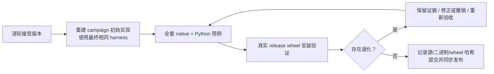

# RSI 操作手册

**语言：中文 | [English](../workflow.md)**

[导航](README.md) · [Profiling](profiling.md) · [正确性](correctness.md) · [证据](evidence.md)

## 0. 先确认环境和所有权

先按[贡献指南](../../docs/zh/contributing.md)配置执行位置；在编写端和执行端各自的仓库根目录核对：

```bash
git status --short
git log -1 --oneline
```

确认两端基线一致、没有未知文件改动和正在运行的候选。活动进程须核对真实 PID/命令；
不要根据历史 lock 文件里的 PID 杀进程。`rsi_per_operator.py` 带 advisory lock，但手工
trial 流程没有全局调度器，必须串行操作，不能两个 shell 同时共享 accepted 缓存。

本地同步和提交是独立阶段：`sync_sources.py` 只发源码，不推进远端 Git HEAD；
`publish_remote.py` 才校验哈希并发布 fast-forward 历史。开始前检查远端脏文件，不能只依赖
HEAD 一致。源同步工具不复制 `.git`、不删除远端文件，但会更新同名源码。

## 1. 冻结 campaign

先读 [历史与失败经验](evidence.md)，再创建新 series。例如 `next-20261027` 只是一个
新名称示例，不表示仓库已经执行了该轮。将 [campaign 模板](templates/campaign.md)
放入 `docs/performance/<series>/PLAN.md` 并填写：

1. baseline commit 与 tree、工具链、Cargo.lock、CPU 型号/拓扑、亲和性、OS 与匿名 run_id；
2. 明确的算子/调用方/输出契约，代表数据规模和输入分布；
3. 固定 cases、计时边界、资源预算、正确性容差；
4. 候选轮数或停止条件、复杂度约束、同一假设允许的一次独立确认规则。

先补缺失的 fixture/guard，再把基准脚手架单独提交。before/after 必须共享同一 harness；
不能把新 fixture 带来的变化算成实现优化。不可变 oracle 仍为最初正确实现，候选性能
baseline 则是最近接受状态，这是两种不同的参照。

## 2. 建立当前接受版本

本地确认清洁基线后同步：

```bash
python3 scripts/sync_sources.py
```

以下在配置的 Linux 执行环境 仓库根目录执行，已有 `.tools` 和 `.venv` 的配置见贡献指南：

```bash
export CARGO_HOME="$PWD/.tools/cargo"
export RUSTUP_HOME="$PWD/.tools/rustup"
export PATH="$CARGO_HOME/bin:$PATH"
export VIRTUAL_ENV="$PWD/.venv"
export CARGO_PROFILE_RELEASE_DEBUG=1
export CARGO_BUILD_JOBS=12
cargo build --locked --release -p mcap-ops-io --example operator_benchmark
.venv/bin/maturin develop --release --locked
mkdir -p .artifacts/rsi/bin .artifacts/rsi/python/accepted/mcap_ops
cp target/release/examples/operator_benchmark .artifacts/rsi/bin/accepted
cp python/mcap_ops/__init__.py python/mcap_ops/_native.abi3.so .artifacts/rsi/python/accepted/mcap_ops/
```

accepted 是可更新的工作缓存，不是永久证据；确认它对应 PLAN 中基线，再开始改源码。
把基线 commit、工具版本、二进制 SHA-256 写入 PLAN/首轮记录，另保存只读副本。
不要将几个月前残留的 accepted 二进制自动认作当前 HEAD。

## 3. 探索与 profiling

沿公开调用入口读完相连代码：Python wrapper → 绑定 → core/io → 输出构造。
先量化时间在哪里，再提出一个改动。例如“30% 耗时用于重复排序，邻近窗口只移动一个点”
比“把 iterator 改成 for 应该更快”更可证伪。

每个候选填写 [experiment 模板](templates/experiment.md)：已有失败是否涉及同一输入？
哪些场景预计受益、哪些可能变慢？完整缓存键是什么？临时内存增长多少？
是否增加数据遍历、预处理、分支、复制或生命周期耦合？

具体命令见 [profiling.md](profiling.md)。可以做短的探索计时，但它不能通过接受门槛。
参数扫描要写明参数扫描；同一补丁的重测不能声称新的算法。

## 4. 本地只改一个候选

声明 owned paths，并确保它们在候选开始前无其他改动。不在同一轮改编译参数、依赖版本、
benchmark 输入和生产算法。不要减少 CRC、验证、样本、输出字段或精度换取速度。

新文件/接口要先有单独 scaffold 提交；当前 trial 用 `git show HEAD:path` 保存旧版本，
因此 owned paths 必须已受 Git 跟踪。

## 5. 运行验证、profile 与配对计时

在本地执行；脚本自动通过 SSH 到 配置的 Linux 执行环境 做全部构建/测试/测量：

```bash
python3 scripts/rsi_trial.py next-align-01 \
  --series next-20261027 \
  --cases align_timestamps.previous,align_timestamps.nearest \
  --paths crates/core/src/time.rs
```

case 列表只是命令格式示例；具体任务应包含预先冻结的全部代表输入（例如稀疏目标）。
Python 候选加 `--python` 并指定 `python.*` cases；PNG 编码候选加 `--png-size-gate`。
使用 `--blocks 8` 可做事先允许的独立确认；普通验收最低 4，不能降为 2。

脚本执行：保存 before/patch → 同步 → baseline profile → fmt/Clippy/Rust tests →
不可变参考差分 → maturin/Python tests → candidate profile → AB/BA 计时 → audit。
Python 路径还运行公开接口对比。格式化结果只回收声明的 owned paths；本地源中途发生变化
会拒绝覆盖。退出失败不会形成有效测量决策，检查 validation.log 后再处理。

`--retry` 用于未形成决策的中断/编译修复，旧日志保存在 attempts/。完成决策的 label
不能重用。独立确认用新 label，保留原决定及其证据；不得反复跑到出现漂亮数字。

## 6. 阅读结果，不把 performance_gate 当完整审批

本地 `.artifacts/rsi/trials/<label>/` 里有 measurement.json、audit.json、验证日志、
前后 profile、candidate.patch 和 before 快照。逐项检查：

- stdout 确实是成功计算，case 集合一致、每侧样本数足够；
- 每块几何平均降低 >=8%，每个 case 中位数退化 <=3%；
- 复杂度/内存/输出大小合适，未改变接口或数据语义；
- 哪个瓶颈实际减少，是否只是布局/噪声偶然变化；
- 正确性覆盖触及的公共行为，浮点变化有事先指定的容差。

机器 gate 主要处理数值门槛；人或代理仍需 review diff、热点解释和复杂度。

## 7. 接受或拒绝

在本地记录决定，填写真实说明，不能照抄占位解释：

```bash
python3 scripts/rsi_decide.py next-align-01 \
  --series next-20261027 --operator align_timestamps --round 1 \
  --method 'Describe the actual implementation change' \
  --hotspot 'Describe the measured baseline hotspot' \
  --complexity 'Describe new branches, memory and maintenance cost' \
  --reason 'Describe why all gates passed' --accept
```

拒绝时去掉 `--accept` 并改 reason。接受会写 results/data 和 commit-message.txt，但不会
自动 commit；拒绝会归档 patch 并恢复 owned paths 的基线内容。决定前会核对 HEAD、当前
patch 和 before 快照；有新改动时拒绝执行，避免误覆盖。已有 decision 文件不允许覆盖。

接受后只暂存本轮文件与证据，查看 staged diff，再使用生成的提交说明：

```bash
git add crates/core/src/time.rs \
  docs/performance/next-20261027/results/next-align-01.json \
  docs/performance/next-20261027/data/next-align-01.json
git diff --cached --stat
git commit -F .artifacts/rsi/trials/next-align-01/commit-message.txt
```

接受后，在配置的 Linux 执行环境 将本轮二进制提升为 accepted，Python 缓存也更新为本轮通过验证的扩展
和 wrapper；只有在两端源码仍与该候选一致时才执行：

```bash
cp .artifacts/rsi/bin/next-align-01 .artifacts/rsi/bin/accepted
cp python/mcap_ops/__init__.py python/mcap_ops/_native.abi3.so .artifacts/rsi/python/accepted/mcap_ops/
```

拒绝不提升缓存；本地恢复后重新同步，下一轮必须基于最近接受状态。拒绝记录可作为独立
`docs(perf)` 提交保存，不伪装成性能成功提交。

## 8. 归档证据与最终集成

本地 trial 完整存在后：

```bash
python3 scripts/archive_extension_evidence.py --series next-20261027
```

它归档验证文本、profile 摘要与哈希，不把巨大的原始 Callgrind 文件提交 Git。
新 series 的 RESULTS/LESSONS 按模板记录；历史 report_* 脚本有固定 baseline/覆盖数量，
不能拿来“生成”新 campaign 的完整通过报告。



运行格式、Clippy、Rust/Python 公共测试、oracle、完整 before/after 和 wheel 安装验证。
profile 构建与正式 wheel 的 debug 选项可能不同：两个计时对象须配置一致，最终必须
计时与交付一致的 release 扩展，并记录 SHA-256；不要比较 debug baseline 和 release candidate。

原 300 轮的 `verify_per_operator.sh` 是特定历史 campaign 的收尾脚本，会写固定报告；
新 campaign 应复用其中检查命令，并改成自己的 baseline 和输出路径，而不是覆盖旧目录。

无新数据/环境变化时，不无限扩大重复测试。通过后本地 commit，运行
`python3 scripts/publish_remote.py` 验证两端哈希与 fast-forward 历史，再正常 `git push`。
Git 分叉或意外改动必须停下调查，不 force push。单项通过与整版交付通过分别报告。
