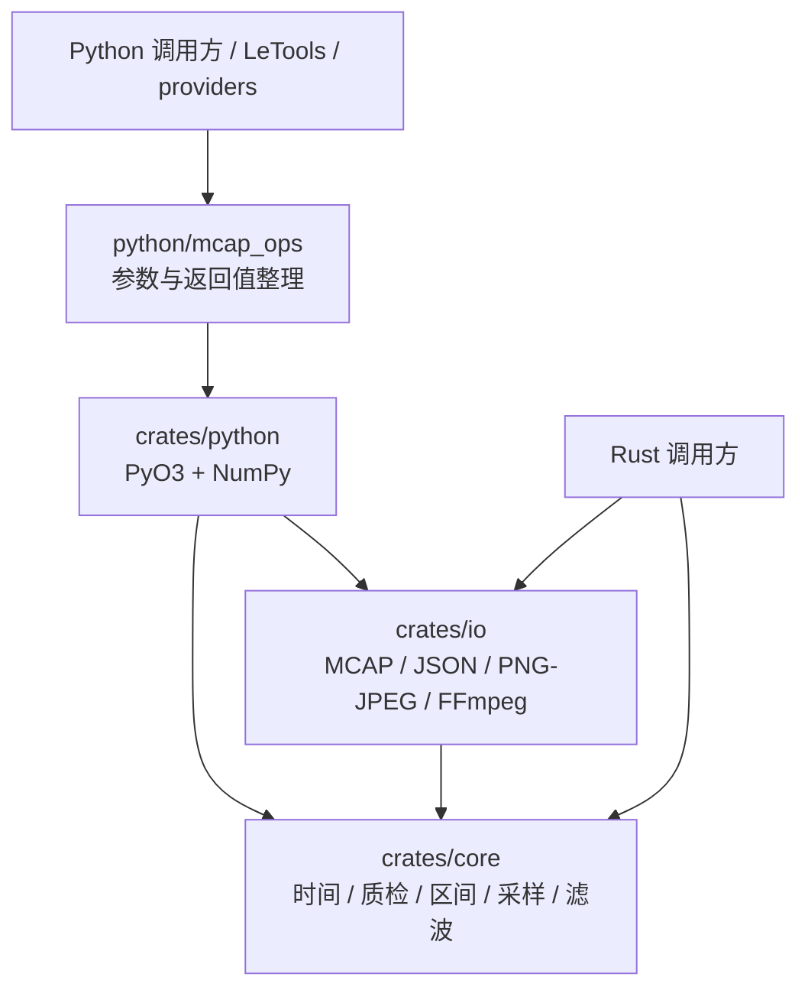
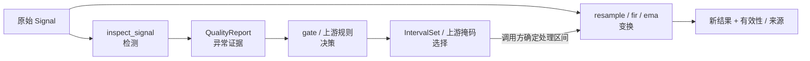
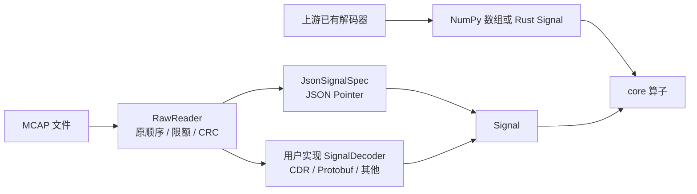
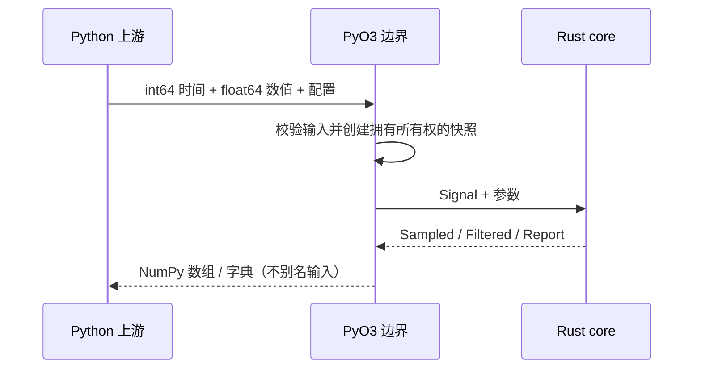

# 设计与架构

[文档导航](README.md) · [抽象与契约](concepts.md) · [算子清单](operators.md)

## 目标：可组合的数据处理能力

同一份录制可能同时用于质量审查、训练集转换和调试。库提供确定的计算和证据，
把 topic 含义、单位、坐标系、示教成功标准、action 定义留给上游。
输入 MCAP 只读，数值变换产生新结果；原始时间戳与源数据不被覆盖。

这里的“算子”是一个明确输入/输出契约的处理函数，例如 Signal → QualityReport，
不特指 GPU kernel、矩阵乘法，也不意味着每个算子自动成为调度节点。

## 依赖方向

| 层 | 对外职责 | 不应进入这一层的内容 |
| --- | --- | --- |
| core | 数组、时间、证据、选取和变换语义 | 文件路径、ROS、Python、机器人 schema、数据集格式 |
| io | 读取容器、解码 payload、调用媒体工具 | 机器人故障判定、训练标签政策、模型特定排列 |
| Python | dtype/shape 边界、所有权转交、易用接口 | 第二套数值算法、隐式单位转换 |
| 上游应用 | schema 解释、策略、调度、输出数据集 | 不需要复制底层算子实现 |

core 是独立 crate；只需要数组算子的 Rust 项目可完全不引入 io。Python 绑定同时
依赖 core 和 io。io 使用 core 的 Signal，但 core 不反向依赖 io。

## 三种动作必须分开

检测输出异常候选，不直接修复；门控输出决策，不直接删除文件；区间选择不把断开的
片段拼接成假连续时间。变换保留失效标记，不用零填充伪装数据。调用者负责把这些接口
组织成流程，目前没有隐藏的 DAG 执行器。

## 核心抽象

| 类型 | 表达什么 | 边界 |
| --- | --- | --- |
| `Signal` | 自有 `Vec<i64>` 时间戳、行主序 `Vec<f64>`、通道数 | 构造只校验 shape；坏值和乱序可进入质检 |
| `SignalSpec` | name、kind、channels、unit、frame、timestamp_source、required | 描述性元数据，由调用方保留；不自动驱动采样或解码 |
| `QualityConfig` / `QualityReport` | 阈值配置、统计、Issue、总数与截断状态 | 异常不等于物理故障，阈值取决于信号单位 |
| `GatePolicy` / `GateDecision` | 拒绝代码、异常比例、最少样本 / pass 与原因 | 是策略判定，非数据修改 |
| `IntervalSet` | 规范化的半开时间区间集合 | 合并相邻/重叠区间，支持交差、掩码和上下文扩展 |
| `SampleOptions` / `Sampled` | 采样方法与时效 / 数值、status、支撑点与权重 | 不自动拟合时钟，不跨超限支撑间隙插值 |
| `Filtered` | 新 Signal、有效性、前视与群延迟 | 与重采样结果结构不同，不提供插值来源索引 |
| `SignalDecoder` | MCAP Message → 零个或多个 DecodedSample | schema-specific Rust 扩展点 |

数据形状、状态码、因果性与错误详见[抽象与数据契约](concepts.md)。

## MCAP 解码是扩展点

内置 JSON 解码只接受明确标记 `message_encoding=json` 的消息。未知 payload 仍可
检查容器和读取 raw message，但不会被猜测成数值。Rust trait 接收 `&mcap::Message`
并返回 `Vec<DecodedSample>`，所以单个消息携带批量样本也能由适配器显式展开。
目前没有动态插件注册表，也没有 Python 回调 Decoder 接口。

## 所有权与性能

1. Python 时间数组要求连续 int64；values 接受 float64 的一维或二维数组，包括跨步视图。
2. 每次调用先复制为 Rust 拥有的快照，避免输出别名及调用中源数组变化带来的不确定性。
3. 数值输出直接交给 NumPy；可转移的 Rust 缓冲转移所有权，小诊断报告仍经 JSON 转换。
4. 当前绑定持有 GIL。没有全局线程池；episode 并发由上游进程调度。
5. 优化先减少重复遍历、分配、排序和转换，再按证据决定是否引入新路径。

IO 不等于全程常量内存：MCAP chunk 需要解压，`read_signal` 收集被选择的数值，
`inspect_mcap` 保存被选择通道的时间戳。上游必须合理设置记录、消息和样本限额。

## 接入边界与取舍

- providers 负责 message 字段、坐标系、单位、关节次序、命令语义与时钟转换参数。
- 算子仓库提供通用计算，不猜测 action 是绝对值、增量还是控制目标。
- LeTools/转换器负责交互、episode 切分、训练/验证拆分、数据集写入和发布。
- 图像质量是亮度、曝光比例、Laplacian 等指标；不是学习型质量评分。
- 视频检查确认首路视频流完整解码，不保证画面有意义，也不重建未知 MCAP 视频包时钟。

尚未实现：自动时钟拟合、CDR/Protobuf 通用解码、Web UI、数据集 writer、GPU 算子、
GIL 释放和线程并行承诺。新增这些能力应沿明确扩展点实现，并单独定义验证契约。

## 开发与证据

源码在本地 authoring checkout 编辑，测试在 reference-linux。原第三方 Xpark 材料被 Git 忽略，
不属于库或许可证范围。构建、测试和同步见[贡献指南](contributing.md)。
性能探索遵循 [RSI 工作流](../RSI/README.md)，完整保存成功与失败记录。
