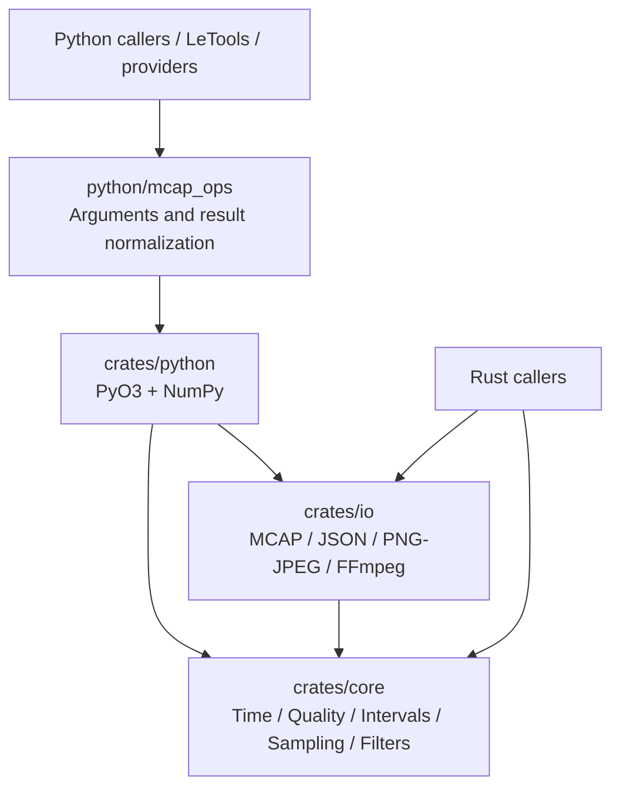
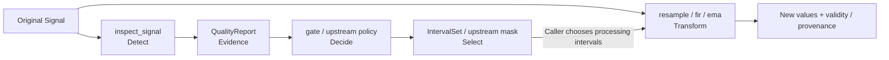
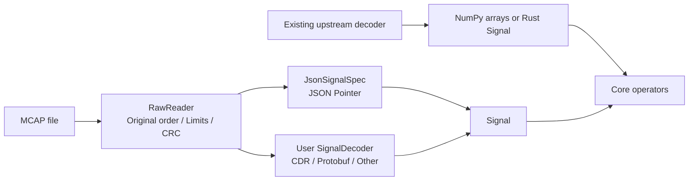
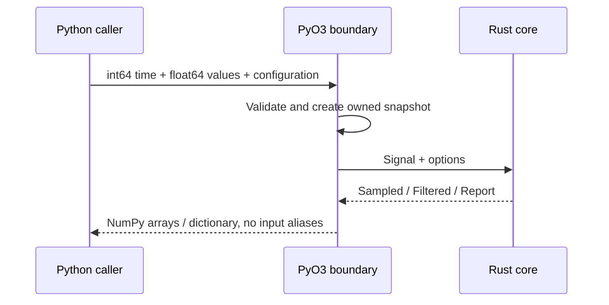

# Architecture and Design

**Language: English | [Chinese](zh/architecture.md)**

[Documentation](README.md) · [Data contracts](concepts.md) · [Operators](operators.md)

## Composable processing, explicit policy

A recording can serve quality review, training-data conversion, and debugging.
The library provides deterministic computation and evidence. Upstream applications
own topic meaning, units, coordinate frames, task success criteria, and action
semantics. MCAP sources are read-only; transformations create new values without
rewriting original timestamps or source data.

An operator here is a function with an explicit input/output contract, such as
`Signal -> QualityReport`. It is not necessarily a GPU kernel, matrix operation,
or independently scheduled node.

## Dependency direction

| Layer | Responsibility | Keep outside this layer |
| --- | --- | --- |
| core | Arrays, time, evidence, selection, transformation semantics | Paths, ROS, Python, robot schemas, dataset formats |
| io | Containers, payload decoding, media tools | Robot fault policy, training-label policy, model-specific ordering |
| Python | dtype/shape boundaries, ownership transfer, convenient interfaces | A second numeric implementation, implicit unit conversion |
| Upstream applications | Schema interpretation, policy, scheduling, dataset writing | Duplicated low-level operators |

Core is an independent crate. Rust applications can use it without IO. Python
bindings depend on both crates; IO uses core's Signal, while core never depends
on IO.

## Detection, selection, transformation

Detection reports candidates without repairing them. Gating makes decisions
without deleting files. Selection does not concatenate disjoint segments into
apparently continuous time. Transformations retain invalidity rather than
inventing zero observations. Callers compose these functions; there is no
hidden DAG executor.

## Core abstractions

| Type | Represents | Boundary |
| --- | --- | --- |
| `Signal` | Owned `Vec<i64>` timestamps, row-major `Vec<f64>` values, channel count | Construction checks shape; bad values and ordering remain inspectable |
| `SignalSpec` | name, kind, channels, unit, frame, timestamp_source, required | Caller-held metadata; does not automatically configure sampling/decoding |
| `QualityConfig` / `QualityReport` | Thresholds, statistics, issues, total count, truncation | Evidence is not proof of a physical fault; thresholds depend on units |
| `GatePolicy` / `GateDecision` | Rejection codes, flagged fraction, minimum samples / pass and reasons | Policy evaluation, not data mutation |
| `IntervalSet` | Normalized half-open time intervals | Merge, intersection, difference, mask, affected-context expansion |
| `SampleOptions` / `Sampled` | Method and support limits / values, status, indices, weights | No clock fitting or interpolation across unsupported gaps |
| `Filtered` | New Signal, validity, lookahead, group delay | Different from Sampled; does not expose interpolation support indices |
| `SignalDecoder` | MCAP Message to zero or more DecodedSample values | Schema-specific Rust extension point |

See [data contracts](concepts.md) for exact shapes, status codes, causality, and errors.

## Schema decoding is an extension point

Built-in JSON extraction requires `message_encoding=json`. Unknown payloads
remain inspectable as containers and raw messages; they are not guessed into
numeric arrays. The Rust trait takes `&mcap::Message` and returns a
`Vec<DecodedSample>`, allowing an adapter to explicitly expand batched samples.
There is no dynamic plugin registry or Python callback-decoder interface.

## Ownership and performance

1. Python timestamps must be contiguous int64; values may be one- or
   two-dimensional float64 arrays, including strided views.
2. Each call creates a Rust-owned input snapshot. Outputs do not alias caller
   buffers; ownership does not depend on the caller retaining an input view.
3. Numeric outputs go directly to NumPy. Owned buffers transfer when supported;
   small diagnostic reports still pass through JSON.
4. Bindings currently hold the GIL. There is no global thread pool; episode-level
   process scheduling belongs upstream.
5. Start by eliminating repeated traversals, allocations, sorting, and conversion.
   Introduce additional paths only when benchmarks justify them.

IO does not imply constant memory: chunks require decompression, `read_signal`
collects selected values, and `inspect_mcap` retains selected timestamps.
Callers must choose appropriate record, message, and decoded-sample limits.

## Integration boundaries

Providers define fields, units, frames, joint order, commands, and clock mappings.
The operator library does not guess whether an action is absolute, relative, or
a controller target. LeTools/converters own UI, episode boundaries, train/validation
splits, dataset writing, and publication.

Image metrics describe luminance, exposure, and Laplacian variance, not learned
quality scores. Video validation checks complete decoding of the first video
stream; it does not establish semantic quality or reconstruct packet timestamps.

Not implemented: automatic clock fitting, universal CDR/Protobuf decoding, a web
UI, dataset writers, GPU operators, or GIL release. Add future capabilities at
explicit seams with their own contracts and validation.

## Development and evidence

Author in a local checkout and execute validation in the configured Linux test
environment. Third-party showcase files are ignored by Git and excluded from
the package. See [contributing](contributing.md) and the
[RSI playbook](../RSI/README.md). Both accepted and rejected experiments remain auditable.
