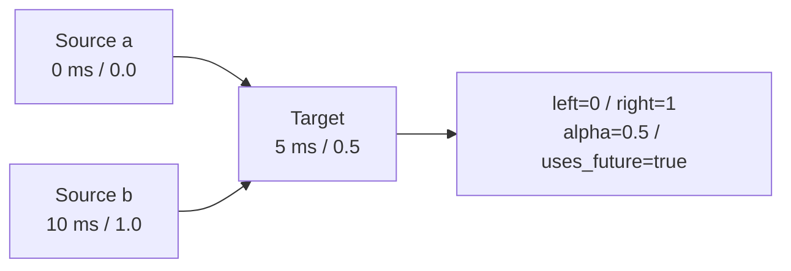

# Data Contracts and Abstractions

**Language: English | [Chinese](zh/concepts.md)**

[Documentation](README.md) · [Architecture](architecture.md) · [Python API](python.md)

## Signal: values travel with time

```text
timestamps: int64[N]       nanoseconds; the caller identifies the clock
values:     float64[N, D]  N samples, D channels

row 0: t0 -> [x0, y0, z0]
row 1: t1 -> [x1, y1, z1]
row 2: t2 -> [x2, y2, z2]
```

Rust stores flat row-major values. Python accepts `(N,)` or `(N,D)` and returns
Signal values as two-dimensional arrays. Input dtypes are not corrected
implicitly. Timestamps, targets, centers, and offsets must be contiguous;
values may be strided or reversed, retaining logical order. Python numeric
outputs normalize non-finite values to NaN; do not assume a Rust Inf remains
Inf after crossing that boundary.

`Signal::new` checks shape only, allowing quality inspection to see disorder
and NaN/Inf. Each transformation validates its own preconditions. Sampling,
EMA, and FIR require strictly increasing source timestamps.

`SignalSpec` is caller-held metadata, not embedded policy. Units and frames are
not converted automatically. A max_rate threshold uses value-units/second;
max_acceleration uses value-units/second squared.

## Time is not an ordinary floating-point axis

- Core timestamps are signed int64 nanoseconds; out-of-range MCAP u64 timestamps
  fail conversion.
- Selection intervals are half-open `[start_ns,end_ns)`. An Issue's `last_ns`
  instead includes the final source sample.
- `uniform_grid` uses rational `rate_num/rate_den` Hz and integer arithmetic,
  avoiding floating-point epoch accumulation.
- `map_clock` takes an explicit origin, offset, and ppb correction. It does not
  estimate clock offsets or sensor response delay.
- Inspect original ordering before deciding to sort, deduplicate, or segment.
  Sorting first can hide a clock reversal.

## Inspection, gating, and selection

`Issue` contains code, optional channel, `[start_index,end_index_exclusive)`,
start_ns, last_ns, metric, and threshold. It currently has no severity field;
upstream policy assigns severity.

`QualityReport` contains time, channels, issues, total_issues,
issues_truncated, flagged_sample_count, and dynamic_checks_completed. Some
dynamic checks are skipped when timestamps are not strictly increasing; the
absence of rate/spike issues then does not prove normal data.

Issue detail is capped at max_issues while total counts and flagged fractions
remain available. Python does not serialize the internal flagged_samples or
all_codes, and does not export gate. Do not reconstruct a supposedly complete
bad-sample mask from truncated issue detail. Rust gate uses the full internal
statistics.

`IntervalSet` represents selection. `affected_centers(history_ns,future_ns)`
expands bad intervals to target centers whose context overlaps them. Preserve
segment boundaries rather than pretending disconnected selections are continuous.

## Resampling: values, validity, source support



| Method | Behavior | Required policy |
| --- | --- | --- |
| previous | Latest source sample at or before the target | max_age_ns; bounded holding after the final source is allowed |
| nearest | Closest source sample; ties prefer the past | allow_future and max_age_ns |
| linear | Linear interpolation between finite supports | max_gap_ns; off-grid values normally need future support |
| slerp | Shortest-path xyzw quaternion interpolation | Four channels; input norm within 0.01 of one, then normalized internally |

max_gap_ns bounds the span between two interpolation supports. max_age_ns bounds
the distance to a single matched sample. Both default to zero, normally permitting
only exact matches. Linear/SLERP do not extrapolate; previous/nearest may retain
an endpoint within the age limit. Exact source matches can remain valid at the
endpoints of an otherwise unsupported gap.

| Code | Name | Meaning |
| ---: | --- | --- |
| 0 | Valid | Supported result |
| 1 | Missing | No usable support |
| 2 | Gap | Interpolation support span exceeds the limit |
| 3 | Stale | Single-sample support exceeds the age limit |
| 4 | NonFinite | Non-finite support or computed output |
| 5 | Future | Future support required but prohibited |
| 6 | InvalidQuaternion | Quaternion requirements are not met |

Invalid values are NaN, source indices are -1, and alpha is NaN. Check valid
before indexing; Python's -1 would otherwise select the last array entry.
uses_future is populated for successful outputs, so False alone does not prove
validity. Validity is row-wise, not per channel: a non-finite required channel
invalidates the sampled row.

## History windows and causality

```text
model center = 20 ms
offsets      = [-15, -10, -5, 0] ms
request time = [  5,  10, 15, 20] ms

values.shape     = (T, W, D)
timestamps.shape = (T, W)
valid.shape      = (T * W,)      current Python API; reshape explicitly
```

Centers are strictly increasing. Offsets are nonempty, strictly increasing,
and nonpositive. status, source_left/right, alpha, and uses_future are also flat
`(T*W,)`, ordered by center first.

Nonpositive offsets constrain requested times, not necessarily source supports.
With `linear, allow_future=True`, a request may consume a source after that
request or even after the model center. Use previous or prohibit future support
for strict online features, and inspect the returned status.

## Filtering is separate from resampling

EMA uses actual dt and a time constant in seconds, resetting after gaps or
non-finite rows. FIR requires a regular period within tolerance, does not pad
unsupported edges, and invalidates support crossing gaps.

lowpass_taps only creates coefficients; resample does not automatically
anti-alias. Before downsampling, choose a lowpass based on the new Nyquist limit
and process supported continuous segments.

| Mode | lookahead_samples | group_delay_samples |
| --- | ---: | --- |
| EMA | 0 | None; frequency-dependent |
| Symmetric causal FIR | 0 | `(tap_count-1)/2` |
| Centered FIR | `tap_count/2` | 0 in output alignment; requires future support |
| Asymmetric causal FIR | 0 | None |

Python EMA/FIR valid is currently `list[bool]`; convert with np.asarray for array
operations. Filters do not shift timestamps to compensate for delay. Angle
unwrapping is explicit and should not be applied to every numeric channel.

## Errors and provenance

Invalid arguments, overflow, bad shape, and invalid ordering fail explicitly.
Representable per-sample missing support returns status instead. Python core,
image, and video failures mainly map to ValueError; MCAP read/decode failures
map to OSError. Binding-level dtype mismatches may raise TypeError.

Provenance is not a complete lineage database. Sampled retains interpolation
support, and MCAP reports retain source/version/schema identity. Upstream
applications should also retain file identity, decoder configuration, clock
mapping, selection policy, and operator version. Image rgb_sha256 hashes dimensions
and decoded RGB content, not the original compressed file.
