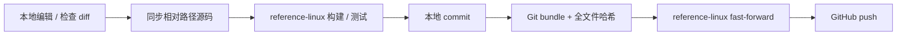

# 贡献、验证与发布

[文档导航](README.md) · [仓库工作规则](../AGENTS.md) · [RSI](../RSI/README.md)

## 日常路径



本地：`.`。执行端：SSH `reference-linux`，
`.`。外部贡献者若无法访问 reference-linux，应提供变更供维护者在
该环境验证，不能将未经验证的平台声称为受支持环境。

开始先核对两端 HEAD 与脏文件。不要覆盖用户修改、远端分叉或其他任务正在使用的工作树。
本地同步工具会更新同名文件，HEAD 检查不能替代手工检查远端工作树。

## 本地编辑与同步

```bash
git status --short
ssh reference-linux 'cd . && git status --short && git log -1 --oneline'
python3 scripts/sync_sources.py
```

该脚本同步 tracked 和非忽略的新文件，按相对路径保留目录。不复制 `.git`，不删除远端
文件，不自动运行测试。新增删除操作应单独审查；发布工具不会替你清理任意旧源码。
Xpark、`.tools`、`.venv`、`.artifacts` 和 wheel 都不应加入 Git。

## reference-linux 的项目本地工具

```bash
cd .
export CARGO_HOME="$PWD/.tools/cargo"
export RUSTUP_HOME="$PWD/.tools/rustup"
export PATH="$CARGO_HOME/bin:$PATH"
export VIRTUAL_ENV="$PWD/.venv"
rustc --version
.venv/bin/python --version
```

工具已在该项目安装；新环境按 getting-started 准备，不借用其他训练/机器人项目环境。
常规验证：

```bash
cargo fmt --all --check
cargo clippy --workspace --all-targets --locked -- -D warnings
cargo test --workspace --locked -j 12
cargo run --locked --release -p mcap-ops-core --example quality_pipeline
.venv/bin/maturin develop --release --locked
.venv/bin/python -m pytest -q tests
.venv/bin/python examples/quickstart.py
```

需要差分/profiling/benchmark 时按 [RSI](../RSI/workflow.md)，不要无理由重跑几百个历史候选。
普通 CI 与共享机器不用于性能接受计时。现有 workflow 是可审计 runbook + CLI，尚未部署
GitHub Actions 或 self-hosted runner，也不要求配置 GitHub SSH secrets。

## 改动覆盖面

- 新算子：公共类型/函数、边界错误、生成 fixture、文档中的单位/shape/因果性。
- Python 导出：PyO3 注册、wrapper、`__all__`、返回类型、公共测试、API 文档。
- Decoder：schema/clock/field 规则、未知编码失败、最大解码样本、原始顺序。
- 性能优化：一候选一假设、完整 before/after、接受单独 commit、失败也归档。
- 文档/示例：检查相对链接、SVG、Mermaid，并在 reference-linux 运行可执行片段。

RSI CLI 的防覆盖测试位于 `tests/test_rsi_workflow.py`，用临时 Git 仓库验证：新 series、
接受不自动 commit、拒绝只恢复 owned paths、旧决定不可覆盖、stale 候选拒绝恢复、
非法命名和不足配对块数在执行前失败。

## Commit 与同步远端历史

审查后只提交相关路径，避免 `git add .` 带入无关内容。性能 commit 用 RSI 生成说明；
文档、验证脚手架和正确性修复独立描述。

```bash
git diff --check
git diff --cached
# git commit ... 完成后，工作树应干净。
python3 scripts/publish_remote.py
```

publish_remote 创建 Git bundle，通过 SSH 验证所有 tracked 文件哈希、目标 tree、无未知
untracked 文件以及 fast-forward 关系，成功后写 `.artifacts/rsi/sync-receipt.json`。
不同历史会拒绝推进，不能用 force/reset 绕过。随后正常推送已授权的 GitHub remote：

```bash
git push origin main
```

## 文档和分发边界

README 的 SVG 为仓库自有资产，Mermaid 在支持的平台渲染，不额外引入文档站构建依赖。
性能原始证据含开发主机路径/版本，是可审计记录；不上传凭据、真实数据或第三方演示包。
PyPI/crates.io/GitHub Release 发布是独立操作，单次 git push 不等于安装包已发布。
