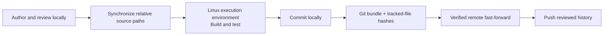

# Contributing, Validation, and Publication

**Language: English | [Chinese](zh/contributing.md)**

[Documentation](README.md) · [Repository rules](../AGENTS.md) · [RSI](../RSI/README.md)

## Separate authoring from execution



Use an isolated Linux x86-64 execution checkout with project-local Rust/Python
tooling. The historical reference environment used 32 logical CPU threads,
a fixed performance-core affinity, Rust 1.90.0, and a release build. See the
[performance guide](performance.md) for the full reproducibility conditions.
A different environment needs its own validation, not a claim of identical speed.

Do not publish deployment aliases, account names, absolute workspace paths, or
boot identifiers. Supply execution coordinates through environment variables or
a Git-ignored `.mcap-ops.local.json` file:

```json
{
  "host": "your-ssh-alias",
  "destination": "/absolute/path/to/mcap-ops"
}
```

These are placeholders, not a working deployment. Alternatively set
MCAP_OPS_TEST_HOST and MCAP_OPS_TEST_ROOT. Explicit sync CLI options take precedence,
then environment variables, then local configuration. The project path must be
absolute and contain no spaces or parent traversal. Never put credentials in
this file; use normal SSH authentication.

Before each sync, compare HEAD and worktree changes on both sides. Do not overwrite
other tasks' edits or divergent history. A matching HEAD alone does not prove
the remote worktree is clean.

## Synchronize reviewed sources

```bash
git status --short
python3 scripts/sync_sources.py
```

The script preserves repository-relative paths and includes tracked and
nonignored new files. It does not copy .git, delete files, advance Git history,
or run tests. It updates same-name source files, so inspect the execution
checkout first. Never add third-party showcase material, tooling, environments,
private configuration, or binary artifacts to Git.

## Project-local tools

At the execution checkout's root:

```bash
export CARGO_HOME="$PWD/.tools/cargo"
export RUSTUP_HOME="$PWD/.tools/rustup"
export PATH="$CARGO_HOME/bin:$PATH"
export VIRTUAL_ENV="$PWD/.venv"
rustc --version
.venv/bin/python --version
```

This assumes the toolchain has been installed into those locations. For a new
environment, follow [getting started](getting-started.md); do not borrow another
training or robot-control project's environment.

```bash
cargo fmt --all --check
cargo clippy --workspace --all-targets --locked -- -D warnings
cargo test --workspace --locked -j 12
cargo run --locked --release -p mcap-ops-core --example quality_pipeline
.venv/bin/maturin develop --release --locked
.venv/bin/python -m pytest -q tests
.venv/bin/python examples/quickstart.py
```

For differential checking, profiling, and benchmarks, follow [RSI](../RSI/workflow.md).
Do not rerun hundreds of historical candidates for an ordinary documentation
change. Shared CI is not a controlled performance-acceptance environment.
The workflow consists of runbooks and CLI tools; no GitHub Actions/self-hosted
runner or SSH secret deployment is implied.

## Scope every change

- Operators: public types, error boundaries, generated fixtures, units, shapes, causality.
- Python exports: bindings, wrapper, __all__, return types, public tests, API documentation.
- Decoders: schemas, clocks, fields, unknown-encoding failures, limits, original ordering.
- Optimizations: one hypothesis, comparable artifacts, separate accepted commits, rejected evidence.
- Documentation: equivalent English/Chinese pages, working links/diagrams, executable snippets.

Workflow safety tests use temporary Git repositories. They cover separate
series, decision preservation, stale-candidate rejection, owned-path restore,
acceptance without implicit commit, invalid names, and minimum paired blocks.

## Commit and publish the execution checkout

Stage only related files and inspect the diff. Keep performance commits separate
from documentation, scaffolding, and correctness fixes.

```bash
git diff --check
git diff --cached
# Commit the reviewed files; the worktree must then be clean.
python3 scripts/publish_remote.py
```

The publication tool transfers a Git bundle, validates tracked-file hashes and
tree identity, checks unexpected untracked files, and requires a fast-forward.
Committed deletions are moved into a local artifact backup only when the remote
file still matches its prior committed bytes. Unexpected edits fail closed.
A local receipt records the verified target; it is not published.

Never bypass divergent history with force/reset. After successful verification,
push the authorized remote normally:

```bash
git push origin main
```

## Documentation and distribution

README graphics are checked-in SVG, with Mermaid diagrams in the guides. There
is no extra documentation-site build dependency. Maintain each English/Chinese
pair together; shared raw measurements remain a single evidence source.
Do not upload credentials, recordings, or third-party demonstration packages.
Registry packages and release attachments are separate deliverables: a Git push
does not publish an installable package.
