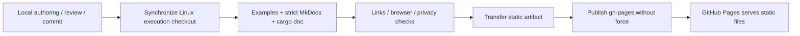

# Building and Publishing the Documentation

**Language: English | [Chinese](zh/documentation-site.md)**

Public site: <https://xieweikai.github.io/mcap-ops/>.
English is the default; Chinese lives under `/zh/`. The language selector keeps
the current page. There are two entry points: **Tutorials** for learning and
**Documentation** for operator/type lookup, plus the full **RSI** playbook.

## Source of truth

| Source | Published content |
| --- | --- |
| `docs/tutorials/`, existing guides | Progressive learning path |
| `docs/reference/python/` | One page for each of 14 Python operators |
| `docs/reference/types.md`, `rust.md` | Type contracts and every public Rust symbol |
| `docs/zh/` | Matching Chinese pages |
| `RSI/`, `RSI/zh/` | Workflow, profiling, correctness, evidence, templates |
| Rust source / `cargo doc` | Exact signatures, fields, methods, traits and source links |
| `docs/performance/` | Shared raw evidence linked to the source revision on GitHub |

The build stages maintained Markdown into `.artifacts/docs/source/{en,zh}`.
It removes GitHub language-switch lines in favor of the theme selector, rewrites
source/evidence links to the same Git revision, and copies shared assets.
No second hand-maintained copy of the guides or RSI is introduced.
Raw experiment logs are not copied into the website or its search index.



## Build and validate

All build/test commands run at the repository root in the configured Linux
execution environment. Use the local-only execution configuration described in
[contributing](contributing.md). Never publish deployment coordinates.

```bash
python3 -m venv .tools/docs
.tools/docs/bin/python -m pip install -r requirements-docs.txt
export CARGO_HOME="$PWD/.tools/cargo"
export RUSTUP_HOME="$PWD/.tools/rustup"
export PATH="$CARGO_HOME/bin:$PATH"
.venv/bin/python -m pytest -q tests
.tools/docs/bin/python scripts/build_docs.py
.tools/docs/bin/python scripts/check_docs_site.py
```

`build_docs.py` uses strict MkDocs validation and rustdoc warnings-as-errors.
It records the source revision and dirty state in `build.json`. A final scan
rejects output containing execution-checkout or home-directory paths.
The checked-in dependencies are documentation-only; the package has no new
runtime dependencies.

For browser preview, serve `.artifacts/docs/site` from the execution environment
and use an authorized local tunnel. Check desktop and mobile navigation,
language switching on an inner page, English/Chinese search, code copying,
Mermaid rendering, and Rust symbol links. Browser checks need Playwright and a
project-local Chromium installation; they are optional development tools, not
site build dependencies. See the runnable commands in
[check_docs_browser.py](../scripts/check_docs_browser.py).

## Publish

1. Commit reviewed source locally. Synchronize via `scripts/publish_remote.py`
   and push `main`. Local, execution, and GitHub source revisions must agree.
2. Build again in the clean execution checkout. Run the site checker and browser
   check. Copy only `.artifacts/docs/site/` back to the same local artifact path.
3. Run `python3 scripts/publish_docs.py` locally with `gh` authentication.
   It checks the clean source revision, complete artifact, and matching GitHub
   main; it commits static files in a disposable clone and pushes `gh-pages`
   without force. No build runs locally.
4. In repository **Settings > Pages**, select **Deploy from a branch**,
   `gh-pages`, `/ (root)` (one-time setup). `.nojekyll` keeps the already-built
   files intact. GitHub's native Pages deployment publishes the static branch;
   no custom CI runner needs access to the execution environment.
5. Wait for the Pages deployment to succeed. Check `build.json` on the live site
   and test the actual `/mcap-ops/` base path.

A newer source commit requires a fresh clean build; dirty/stale artifacts are
refused. A concurrent `gh-pages` update causes a non-fast-forward failure rather
than overwriting it. Review that update before retrying.

## Editing rules

- Add English and Chinese pages together, and include them in `mkdocs.yml`.
- Every Python reference page has a real public signature and a runnable
  generated-fixture example. Tests compare signatures/defaults with the installed
  package and run both language versions.
- Preserve Markdown-relative links so documents also work on GitHub.
- Rustdoc is generated, not translated or edited by hand; bilingual conceptual
  pages explain the same types and link to the shared exact reference.
- Keep history, source data, private artifacts, and execution coordinates out
  of the static branch. The README banner remains the shared vector asset.
