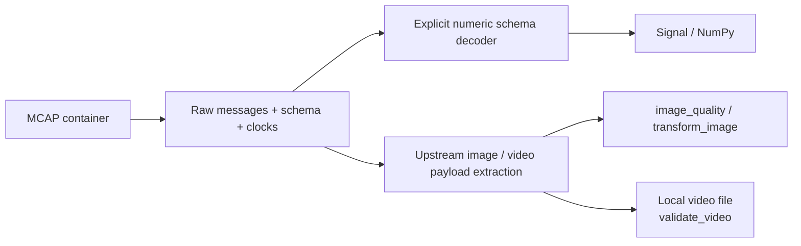

# MCAP, Images, and Video

**Language: English | [Chinese](../zh/guides/media.md)**

[Documentation](../README.md) · [Python API](../python.md) · [Rust decoders](../rust.md)

## Container and payload are separate boundaries



A readable container does not imply an understood payload. JSON numeric extraction
is built in; CDR/Protobuf, compressed-image schemas, video packet assembly, and
packet timestamps belong to upstream adapters.

## Inspect and extract JSON

Suppose topic /state has `message_encoding=json` and payload
`{"t_ns":10000000,"position":[0.1,0.2,0.3]}`:

```python
import mcap_ops as ops

path = "/data/example.mcap"  # Replace with your read-only source.
inventory = ops.inspect_mcap(
    path,
    filter={"topics": ["/state"]},
    limits={"max_record_bytes": 64*1024*1024, "max_messages": 1_000_000},
    max_gap_ns=100_000_000,
)
signal = ops.read_json_signal(
    path, topic="/state", fields=["/position"], channels=3,
    filter={"topics": ["/state"]},
    timestamp_pointer="/t_ns",
    max_samples=1_000_000,
)
print(signal["values"].shape)  # (N, 3)
```

Pointers such as /pose/position/0 follow RFC 6901; escape keys containing / or ~.
Missing/nonnumeric fields, wrong channel counts, and invalid timestamps fail
rather than silently skipping messages. Without timestamp_pointer, output uses
log_time, or publish_time if publish_clock=True. filter.publish_clock separately
selects the clock used for filtering.

Reading preserves file order and validates present chunk/data/summary CRCs.
Zero CRC means absent, not passed. Early RawReader termination is not whole-file
validation, and sources must remain unchanged while open.

max_record_bytes limits records, max_messages limits the scan, and max_samples
limits decoded output. They are not total-memory limits: decompression,
timestamp statistics, and collected values consume additional memory.

## Image metrics and transformation

```python
from pathlib import Path
import json
import mcap_ops as ops

raw = Path("frame.jpg").read_bytes()
limits = {"max_width": 4096, "max_height": 4096, "max_pixels": 16_000_000}
quality = ops.image_quality(raw, options=limits)

# crop=[x,y,width,height] must fit; resize does not preserve aspect ratio automatically.
png = bytes(ops.transform_image(
    raw, options_json=json.dumps(limits),
    resize=[224, 224], filter="lanczos3",
))
# New PNG data; the caller decides whether and where to save it.
```

Mean/std use weighted RGB luminance. Dark/bright fractions are threshold
statistics; Laplacian variance can inform blur review but has no universal
cross-scene pass threshold. rgb_sha256 compares decoded dimensions and RGB
content, not original file bytes or semantic similarity across viewpoints.

Only PNG/JPEG are supported. transform_image returns list[int], requiring
bytes() for byte consumers. Resizing changes pixels; lossless PNG encoding does
not imply that resizing preserves the original image.

## Video integrity

```python
video = ops.validate_video(
    "/data/episode.mp4",
    ffmpeg="ffmpeg", ffprobe="ffprobe", timeout_seconds=120.0,
)
assert video["complete"] and video["decoded"]
print(video["decoded_frames"])
```

External tools receive argument arrays, not shell fragments. The adapter accepts
local files, probes, and completely decodes the first video stream. Timeout,
error diagnostics, missing frames, or a missing completion marker fail.
Success does not certify visual meaning, audio integrity, or return frame arrays.

For model synchronization, retain frame timestamps, select indices with
align_timestamps, then process the selected frames. Average FPS cannot reconstruct
exact capture times.
