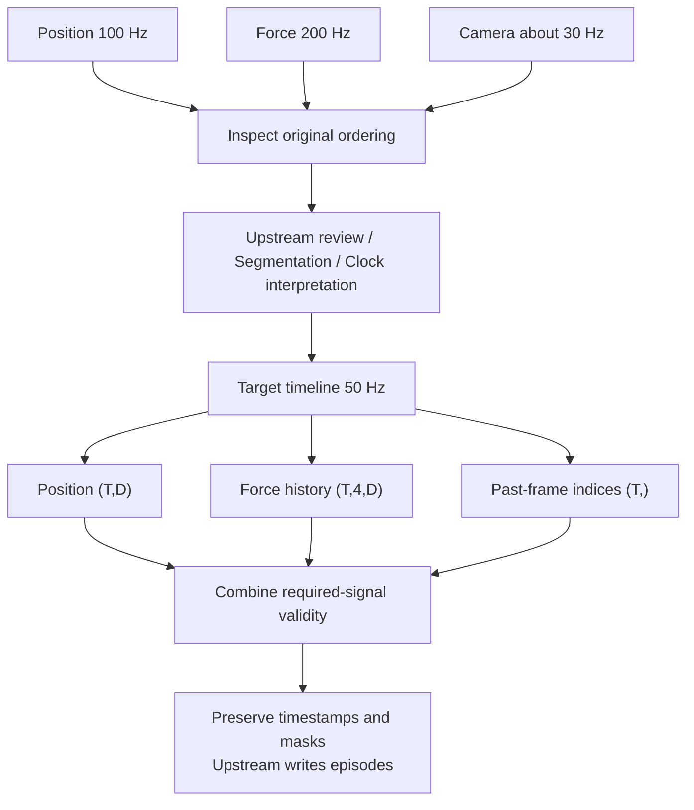

# From Multiple Signals to Model Steps

**Language: English | [Chinese](../zh/guides/pipeline.md)**

[Documentation](../README.md) · [Contracts](../concepts.md) · [Python API](../python.md)

## Choose semantics before a sampling method

| Signal | Possible processing | Explicit policy |
| --- | --- | --- |
| Continuous position | linear; previous for causal observations | Units, support gap, future permission |
| Commands/modes | previous | Validity age and treatment of stale commands |
| Quaternions | slerp | xyzw, norm requirements, frame |
| Force/IMU | High-frequency history or lowpass then downsample | Bandwidth, latency, preservation of impacts |
| Images | align_timestamps selects frame indices | Maximum frame age; never index invalid -1 |
| Events | Preserve event time and aggregate upstream | Continuous interpolation may be inappropriate |

These are composition choices, not hidden library policy. Signals must first
share comparable clocks. Similar numbers do not establish a common clock.
map_clock is currently Rust-only and requires explicit correction parameters.



## Runnable example

These arrays are generated. Replace them with decoded observations without
changing their unit and shape contracts.

```python
import numpy as np
import mcap_ops as ops

ms = 1_000_000
joint_t = np.arange(0, 101, 10, dtype=np.int64) * ms
joint_x = np.column_stack([joint_t / 1e9, joint_t / 1e9 * 2]).astype(np.float64)
force_t = np.arange(0, 101, 5, dtype=np.int64) * ms
force_x = np.ones((len(force_t), 6), dtype=np.float64)
frame_t = np.array([0, 33, 67, 100], dtype=np.int64) * ms

grid = np.asarray(ops.uniform_grid(20*ms, 101*ms, 50, 1, 100), dtype=np.int64)
report = ops.inspect_signal(joint_t, joint_x, {"max_gap_ns": 15*ms})
assert report["total_issues"] == 0

joint = ops.resample(joint_t, joint_x, grid, method="previous", max_age_ns=15*ms)
force = ops.history_windows(
    force_t, force_x, grid,
    np.array([-15, -10, -5, 0], dtype=np.int64) * ms,
    max_age_ns=5*ms,
)
frames = ops.align_timestamps(frame_t, grid, max_past_ns=40*ms)

force_valid = force["valid"].reshape(len(grid), 4).all(axis=1)
step_valid = joint["valid"] & force_valid & frames["valid"]
assert joint["values"].shape == (5, 2)
assert force["values"].shape == (5, 4, 6)
assert step_valid.all()
```

Image matching selects indices, not interpolated compressed bytes. Check
frames.valid before indexing. Several model steps may reuse one frame.

## Quality selection

Python can use reports for business decisions, but gate/IntervalSet are
currently Rust-only. Use Rust or an explicit upstream policy for interval
operations. Truncated issue detail is not a complete bad-sample mask.

Impacts, contact, and long periods of stillness can be desired behavior. Define
which codes reject an episode, which require review, and whether bad intervals
invalidate history-window centers.

Do not filter values by step_valid and fabricate a continuous timeline.
Preserve the mask or split into contiguous valid episodes with original time
and provenance.

## Downsampling and delay

resample is not an anti-aliasing filter. For regular high-rate signals, use
lowpass_taps and fir before downsampling supported segments. When converting
200 Hz to 50 Hz, choose a cutoff below the new 25 Hz Nyquist limit, based on the
signal bandwidth. A symmetric causal 31-tap FIR delays the signal by 15 input
steps, or 75 ms; centered mode instead needs 75 ms of lookahead.

Training features must obey deployment causality. Equal output timestamps do
not automatically compensate for processing delay.

## Upstream persistence

Retain source identity, topics/fields/units, clock source and mapping, operator
version/configuration, original and target timestamps, valid/status,
source_left/right/alpha, and segmentation policy. The library does not include
a dataset writer; the consuming pipeline owns serialization.
