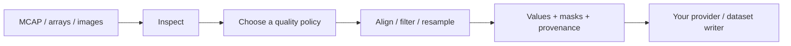

---
hide:
  - navigation
  - toc
---

# From streams to model steps.

**Language: English | [Chinese](zh/index.md)**

MCAP Ops is a standalone Rust library with NumPy interfaces for inspecting
recordings and preparing model inputs. Preserve the clock, the validity mask,
and the source support alongside every value.

[Start the tutorial](tutorials/first-pipeline.md){ .md-button .md-button--primary }
[Find an API](reference/index.md){ .md-button }

- **Tutorials**

    Learn why the interfaces separate inspection, selection, and transformation.
    Install from source and build a pipeline using generated signals.

    [Follow the learning path](tutorials/index.md)

- **Documentation**

    Look up all 14 Python operators, their exact signatures, options, outputs,
    errors, and examples. Explore Rust types, methods, and decoder abstractions.

    [Browse the API reference](reference/index.md)

- **RSI**

    Follow the profiling, correctness, benchmark, and acceptance workflow.
    Study 380 preserved decisions, including rejected optimizations.

    [Read the playbook](../RSI/README.md)

## From recordings to model steps

**Current interface: 0.1.0.** Install from source; there is no PyPI or crates.io
release. Core works with arrays independently of MCAP, ROS, and robot schemas.
CDR/Protobuf decoding, dataset writing, scheduling, and clock estimation belong
to upstream adapters. See [installation and verified platforms](getting-started.md).

English and Chinese guides cover the same APIs. Compiler-generated Rust
signatures and historical measurement artifacts are shared.
