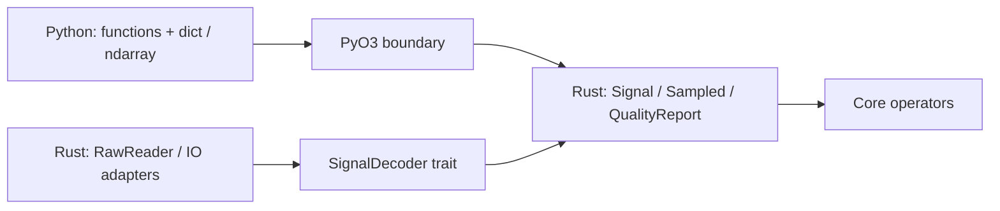

# Documentation

**Language: English | [Chinese](../zh/reference/index.md)**

Version **0.1.0**. This is the lookup reference; for a learning sequence, use
[Tutorials](../tutorials/index.md).

## Python operators

Import `mcap_ops as ops`. Each symbol has a signature, parameter/default table,
return contract, failure behavior, and a complete example.

| Category | Operator | Result |
| --- | --- | --- |
| Quality | [inspect_signal](python/inspect_signal.md) | Timing, channel statistics, issues |
| Time | [uniform_grid](python/uniform_grid.md) | Rational-rate nanosecond grid |
| Time | [align_timestamps](python/align_timestamps.md) | Matched indices, offsets, validity |
| Sampling | [resample](python/resample.md) | Values, validity, source support |
| Sampling | [history_windows](python/history_windows.md) | Time-windowed values and support |
| Filtering | [ema](python/ema.md) | Time-aware causal smoothing |
| Filtering | [lowpass_taps](python/lowpass_taps.md) | FIR coefficients |
| Filtering | [fir](python/fir.md) | Filtered values and delay metadata |
| Filtering | [unwrap_angles](python/unwrap_angles.md) | Continuous periodic values |
| MCAP | [inspect_mcap](python/inspect_mcap.md) | Container/channel quality report |
| MCAP | [read_json_signal](python/read_json_signal.md) | Explicitly decoded numeric signal |
| Images | [image_quality](python/image_quality.md) | Exposure, sharpness, RGB hash |
| Images | [transform_image](python/transform_image.md) | Cropped/resized PNG |
| Video | [validate_video](python/validate_video.md) | Complete first-stream decoding report |

`ops.__version__` is a string. Private `_native` symbols are not a public API.

## Common input contract

| Input | Contract |
| --- | --- |
| timestamps, source, target, centers, offsets | Contiguous 1-D `numpy.int64`, nanoseconds |
| values | `numpy.float64`, `(N,)` or `(N,D)`; strided and reversed views accepted |
| FIR coefficients | Contiguous 1-D `numpy.float64` |
| Numeric ownership | Inputs copied into Rust-owned snapshots; output does not alias input |
| Execution | Calls currently hold the GIL |
| Configuration | Dictionaries for wrapper APIs; `transform_image.options_json` is a JSON string |
| Errors | Core validation -> ValueError; core arithmetic overflow -> OverflowError; IO errors -> ValueError; argument conversion can raise TypeError/OverflowError |

`N` is source sample count, `D` channels, `M` target steps, `T` window centers,
and `W` offsets per window. No implicit dtype, unit, frame, clock, or schema
conversion is performed. Sampling/filtering requires ordered time; inspection
accepts original order to detect problems.

## Types, classes, and abstractions

Python returns dictionaries, lists, and NumPy arrays. It does not export a
`Signal` or `IntervalSet` Python class. The [types guide](types.md) maps those
results to their Rust structs and explains masks, status, and configuration.

The [Rust symbol index](rust.md) links every public type and function to
compiler-generated documentation, including fields, methods, trait
implementations, and source. It covers Rust-only quality gates, interval sets,
clock mapping, readers, and the `SignalDecoder` extension point.

See [data contracts](../concepts.md) for clock semantics and provenance,
or the [compact Python reference](../python.md) for all signatures on one page.
