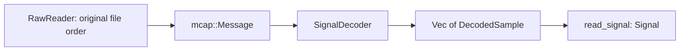

# Types and Abstractions

**Language: English | [Chinese](../zh/reference/types.md)**

These names are Rust types. Python exposes the corresponding data as ordinary
dictionaries, arrays, and lists; it does not wrap them as classes.
Use the [Rust symbol index](rust.md) for exact fields and methods.

## Signal and SignalSpec

| Type | Purpose / contract |
| --- | --- |
| `Signal` | Owned `Vec<i64>` nanosecond timestamps, row-major `Vec<f64>` values, positive channel count |
| `Signal::new` | Validates `timestamps.len() * channels == values.len()`; does not enforce ordering or finiteness |
| `Signal::require_ordered` | Validates strict timestamp ordering explicitly |
| `Signal::timestamps / values / row` | Borrow slices; `row(index)` requires an in-range index |
| `Signal::len / is_empty / channels` | Inspect shape without copying |
| `Signal::into_parts` | Consumes the signal and transfers `(timestamps, row-major values, channels)` without copying |
| `SignalSpec` | name, kind, channels, unit, frame, timestamp_source, required |
| `SignalKind` | Continuous, QuaternionXyzw, Command, Discrete, Event |

`SignalSpec` is descriptive metadata, not an automatic dispatch or conversion
engine. Python Signal dictionaries contain `timestamps: int64[N]`,
`values: float64[N,D]`, and `channels: int`. Metadata remains upstream.

## Quality reports and policies

| Type | Fields / meaning |
| --- | --- |
| `TimeStats` | samples, first_ns, last_ns, reversals, duplicates, gaps, positive_interval_min/median/p95/max_ns, estimated_hz |
| `ChannelStats` | finite, nonfinite, min, max, mean, std, statistics_overflow |
| `Issue` | code, channel, start_index, end_index_exclusive, start_ns, last_ns, metric, threshold |
| `QualityReport` | time, channels, issues, total_issues, issues_truncated, dynamic_checks_completed, flagged_sample_count |
| `QualityConfig` | Detection thresholds and resource caps; [complete defaults](python/inspect_signal.md) |
| `GatePolicy` | reject_codes, max_flagged_fraction in [0,1], min_samples |
| `GateDecision` | passed, reasons, flagged_fraction |

Unavailable statistics are `None`. `Issue.channel` may be `None` for time
issues. There is no severity field. Its index span is half-open, but `last_ns`
is the inclusive last source timestamp.

`IssueCode` serializes as `non_finite`, `below_range`, `above_range`,
`clock_reversal`, `duplicate_time`, `gap`, `rate`, `acceleration`, `spike`,
or `flatline`. `gate` uses full internal flags/codes even when issue detail is
truncated. Python reports exclude `flagged_samples` and `all_codes`; use the
complete counts or an explicit upstream policy, not a reconstructed partial mask.

## SampleOptions, Sampled, Windowed, and Status

`SampleOptions` has method, max_gap_ns, max_age_ns, allow_future.
`Method` is Previous, Nearest, Linear, or Slerp. Limits are explicit in Rust;
Python sampling defaults both limits to zero.

| Field | Python Sampled | Python Windowed |
| --- | --- | --- |
| timestamps | int64 `(M,)` | int64 `(T,W)` |
| values | float64 `(M,D)` | float64 `(T,W,D)` |
| channels | int | int |
| centers, offsets | absent | int64 `(T,)`, `(W,)` |
| status | uint8 `(M,)` | uint8 `(T*W,)` |
| valid | bool `(M,)` | bool `(T*W,)` |
| source_left/right | int64 `(M,)` | int64 `(T*W,)` |
| alpha | float64 `(M,)` | float64 `(T*W,)` |
| uses_future | bool `(M,)` | bool `(T*W,)` |

Rust uses flat vectors and `Windowed.samples`, with centers/offsets describing
shape. Source indices refer to the passed signal, not raw file message IDs.
Single-sample support repeats one index with alpha=0. Validity applies to
the complete row, not individual channels.

| Code | Rust Status | Meaning |
| ---: | --- | --- |
| 0 | Valid | Supported, finite row |
| 1 | Missing | Required support absent |
| 2 | Gap | Two-point support interval exceeds limit |
| 3 | Stale | Single-point support exceeds age limit |
| 4 | NonFinite | Nonfinite input/output |
| 5 | Future | Future support forbidden |
| 6 | InvalidQuaternion | Quaternion fails norm requirements |

Invalid outputs use NaN values/alpha and source indices -1. Consult status;
do not infer failure type from NaN alone. `valid` is exactly `status == 0`.

## TimeAlignment and Filtered

`TimeAlignment` contains indices, offsets_ns (source minus target), and valid.
It selects samples without changing their values.

`Filtered` contains a Signal, valid, mode, lookahead_samples, and
group_delay_samples. Python flattens Signal fields into the result dictionary;
its valid remains a **list**, not an ndarray. `FilterMode` is Causal/Centered.
Unknown constant group delay is `None`; a zero reported delay does not imply
zero lookahead.

## Interval and IntervalSet

`Interval { start_ns, end_ns }` represents `[start,end)`.
`IntervalSet::new` rejects empty/reversed intervals, sorts them, and merges
overlaps/adjacency. `intervals` borrows the normalized spans. `contains`, `mask`,
`intersection`, and `difference` query/select without changing source data.
`mask` accepts unordered times. `affected_centers(history_ns,future_ns)` expands
bad intervals to centers whose context touches them, with overflow checks.
These APIs are Rust-only.

## Readers and decoder abstraction

- `RawReader::open(path, MessageFilter, ReadLimits)` returns a fallible iterator.
  Early termination does not validate the whole file.
- `MessageFilter` and `ReadLimits` defaults are listed on
  [inspect_mcap](python/inspect_mcap.md). They describe scan selection and limits.
- `SignalDecoder::channels()` declares dimensionality;
  `decode(&Message) -> Result<Vec<DecodedSample>>` supplies samples.
- `DecodedSample` contains timestamp_ns and values. Zero samples mean an
  irrelevant message; many samples can represent a batch.
- `JsonSignalSpec` contains topic, fields, channels, timestamp_pointer,
  publish_clock. It implements `SignalDecoder` for explicit JSON fields.
- `McapReport` / `ChannelReport`, `ImageOptions` / `ImageQuality`, and
  `VideoValidation` are described on their respective operator pages.

The decoder owns schema, unit, and clock interpretation. The core never guesses
them. See the [extension example](../rust.md).

## Errors

Core `Error` has `Invalid(String)` and `Overflow`. IO `Error` preserves IO,
MCAP, Core, Json, and Image errors and adds Invalid. `Result<T>` is each crate's
result alias. Python maps these at the binding boundary as described in the
[common contract](index.md).
