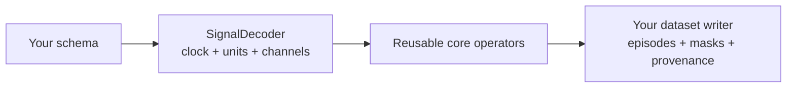

# Best Practices

**Language: English | [Chinese](../zh/tutorials/best-practices.md)**

## Keep the data contract beside the signal

| Decision | Record explicitly | Failure avoided |
| --- | --- | --- |
| Time | int64 ns, source clock, correction parameters | Mixing log, publish, and payload clocks |
| Values | Channels, units, frame, quaternion order | Plausible values with wrong physical meaning |
| Validity | status, mask, gap and age limits | Treating missing or stale samples as observations |
| Causality | allow_future, lookahead, group delay | Training on observations unavailable at deployment |
| Selection | Gate thresholds, interval and episode policy | Hiding gaps by concatenating surviving rows |
| Provenance | Source identity, fields, version, configuration, support indices | Outputs that cannot be reconstructed |

The library does not infer these decisions from topic names.

## Choose a representation for the signal

- Commands and modes: `previous` with a meaningful maximum age.
- Continuous observations: `previous` for causal features; `linear` only when
  future support is allowed.
- Orientations: four-channel xyzw `slerp`, with explicit frame and norm checks.
- Images: align timestamps, validate indices, then select whole frames.
- Force and IMU: keep high-frequency history when impacts matter. For downsampling,
  design an anti-aliasing filter and account for its delay.

`resample` does not anti-alias automatically. A 31-tap symmetric causal FIR
has 15 input steps of group delay; centered mode uses future context. Equal
output timestamps alone do not remove either effect.

## Process bounded, meaningful units

Inspect a recording, then work by episode or supported segment. Set read limits
and `max_samples` from the workload. A record limit is not an RSS limit, and
image transforms allocate decoded pixels. Video validation decodes the complete
first video stream; container probing alone is a weaker check.

Python arrays are copied into Rust-owned snapshots and the GIL remains held.
Use process-level parallelism upstream only after measuring memory and IO
contention. Do not assume a Python thread pool makes operators parallel.

## Extend at the boundary

Keep schema decoding in providers or the IO layer. Keep dataset formats and
scheduling upstream. Extend the core only when the operation makes sense for
arrays without knowing a robot or file format.

Run public-interface correctness tests before benchmarking. Use the
[RSI playbook](../../RSI/README.md) for performance work; historical speedups do
not establish throughput on your data.
