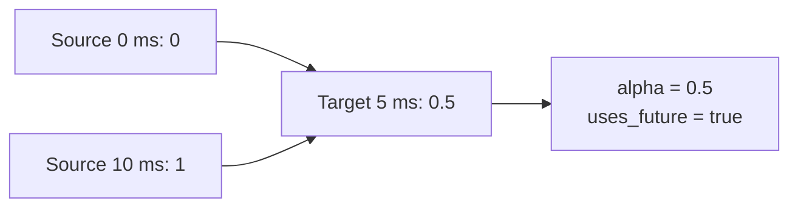

# Your First Pipeline

**Language: English | [Chinese](../zh/tutorials/first-pipeline.md)**

After [installation](../getting-started.md), run this complete example.
It turns a 100 Hz scalar signal into a 200 Hz signal.

```python
import numpy as np
import mcap_ops as ops

t = np.array([0, 10, 20], dtype=np.int64) * 1_000_000
x = np.array([0.0, 1.0, 2.0], dtype=np.float64)
report = ops.inspect_signal(t, x, {"max_gap_ns": 15_000_000})
assert report["total_issues"] == 0

grid = np.asarray(ops.uniform_grid(0, 25_000_000, 200, 1, 100), dtype=np.int64)
sampled = ops.resample(
    t, x, grid, method="linear",
    max_gap_ns=15_000_000, allow_future=True,
)
np.testing.assert_allclose(sampled["values"][:, 0], [0, 0.5, 1, 1.5, 2])
assert sampled["valid"].all()
assert sampled["source_left"].tolist() == [0, 0, 1, 1, 2]
assert sampled["source_right"].tolist() == [0, 1, 1, 2, 2]
print(sampled["values"][:, 0])
```

Output: `[0.  0.5 1.  1.5 2. ]`.

## Read the support, not just the values

| Target time | Value | Source indices | Uses future |
| --- | ---: | --- | --- |
| 0 ms | 0 | 0, 0 | false |
| 5 ms | 0.5 | 0, 1 | true |
| 10 ms | 1 | 1, 1 | false |
| 15 ms | 1.5 | 1, 2 | true |
| 20 ms | 2 | 2, 2 | false |



The 5 ms output needs the 10 ms observation. That is suitable only when your
feature policy permits future support. For a causal observation, change the
call to `method="previous", max_age_ns=15_000_000` and keep the default
`allow_future=False`; the output becomes `[0, 0, 1, 1, 2]`.

## Make failures visible

Zero age/gap tolerances are strict, not unlimited. Missing support produces
an invalid mask and NaN values. Always retain the target timestamps and masks;
do not silently turn failed samples into zeros.

Next: [inspect and select](quality.md), or look up
[resample](../reference/python/resample.md).
