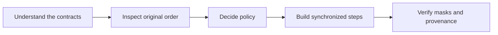

# Tutorials

**Language: English | [Chinese](../zh/tutorials/index.md)**

Start here to learn the library. If you know the function name, use the
[API reference](../reference/index.md) instead.

| Step | Read | What you will be able to do |
| --- | --- | --- |
| 1 | [Design philosophy](../architecture.md) | Separate domain policy from reusable numeric operators |
| 2 | [Installation](../getting-started.md) | Build the native package in an isolated environment |
| 3 | [First pipeline](first-pipeline.md) | Inspect and resample a signal, then interpret its source support |
| 4 | [Inspect and select](quality.md) | Translate quality evidence into an explicit acceptance policy |
| 5 | [Synchronize model steps](../guides/pipeline.md) | Combine positions, force histories, and frame indices |
| 6 | [MCAP and media](../guides/media.md) | Extract JSON signals, check images, and validate video decoding |
| 7 | [Best practices](best-practices.md) | Preserve timing, causality, limits, and reproducibility upstream |

Examples use generated data. They do not require robotics services or a
downloaded dataset. Numeric examples need NumPy and an installed `mcap_ops`;
media examples also use Pillow, the Python `mcap` package, and FFmpeg where stated.

The learning path borrows the separation of tutorials and reference from
[PyTorch](https://docs.pytorch.org/tutorials/) and
[Polars](https://docs.pola.rs/user-guide/), with reference pages organized around
signature, parameters, returns, errors, and examples. MCAP Ops has its own time
and quality contracts; tensor-library conventions do not override them.
