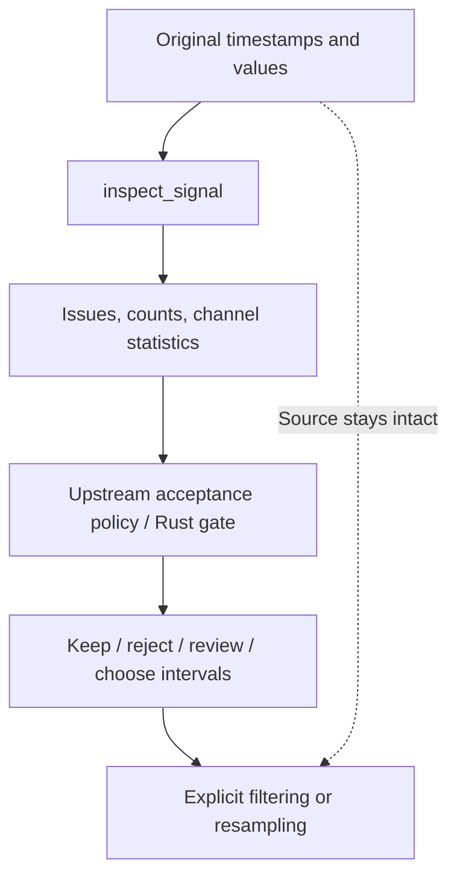

# Inspect, Then Decide

**Language: English | [Chinese](../zh/tutorials/quality.md)**

Inspection reports facts. Your application decides whether a recording is useful.
A large force derivative can be a contact event; stillness can be a valid task.

```python
import numpy as np
import mcap_ops as ops

t = np.arange(4, dtype=np.int64) * 10_000_000
x = np.array([0.0, 0.2, 8.0, 0.3], dtype=np.float64)
report = ops.inspect_signal(t, x, {"lower": [-1.0], "upper": [1.0]})
assert report["total_issues"] == 1
issue = report["issues"][0]
assert issue["code"] == "above_range"
assert (issue["start_index"], issue["end_index_exclusive"]) == (2, 3)

# This application rejects any flagged sample; the library does not decide.
accepted = report["flagged_sample_count"] == 0
assert not accepted
np.testing.assert_array_equal(x, [0.0, 0.2, 8.0, 0.3])
```

## Three different operations



1. **Detect:** inspect original file order before sorting or deduplicating.
   Clock reversals are evidence; sorting would erase them.
2. **Select:** use an explicit upstream policy or Rust `gate` / `IntervalSet`.
   Neither is currently a Python export.
3. **Transform:** filter or interpolate only under an explicit policy.
   Inspecting an issue never edits the signal.

## Bounded detail is not a complete mask

`max_issues` limits stored details, not `total_issues` or
`flagged_sample_count`. If `issues_truncated` is true, the issue list cannot
reconstruct every bad sample. Rust keeps complete internal flags for gating;
those internal vectors are not exported in the Python report.

Dynamic checks require ordered time. Check `dynamic_checks_completed`; a report
with reversals does not certify that all rate, acceleration, or window checks ran.
`Issue.last_ns` is inclusive; `IntervalSet` uses half-open `[start,end)`.
Choose sample coverage and overflow handling before converting between them.

Next: [synchronize model steps](../guides/pipeline.md).
Reference: [inspect_signal](../reference/python/inspect_signal.md),
[quality types](../reference/types.md), [Rust selection](../reference/rust.md).
