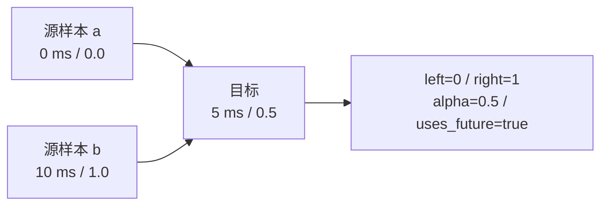

# 抽象与数据契约

**语言：中文 | [English](../concepts.md)**

[文档导航](README.md) · [架构](architecture.md) · [Python API](python.md)

## Signal：时间与数值必须一起传递

```text
时间 timestamps: int64[N]       单位 ns，调用方明确时钟来源
数值 values:     float64[N, D]  N 行样本，D 个通道

row 0:  t0 -> [x0, y0, z0]
row 1:  t1 -> [x1, y1, z1]
row 2:  t2 -> [x2, y2, z2]
```

Rust 存储为行主序平坦数组；Python 可输入 `(N,)` 或 `(N,D)`，数值输出统一为二维。
Python 输入 dtype 不会自动纠正；时间/target/centers/offsets 要连续内存，values
可以是跨步或反向视图，逻辑次序保持不变。Python 数值输出将非有限值统一为 NaN，
这是当前绑定契约；不要假定 Rust 中的 Inf 经 Python 返回后仍为 Inf。

`Signal::new` 只验证维度。这样乱序和 NaN/Inf 可以被质检看见，而不是在读取时被丢掉。
变换各自验证前提；重采样、EMA、FIR 等要求源时间戳严格递增。

`SignalSpec` 是调用者持有的描述信息，不嵌入 Signal；单位/坐标系不会自动转换。
例如 max_rate 的单位是“数值单位/秒”，max_acceleration 是“数值单位/秒²”。

## 时间轴不是普通浮点数列

- 所有核心时间戳是有符号 int64 纳秒；MCAP 的 u64 超出范围时拒绝转换。
- 区间为半开 `[start_ns, end_ns)`；Issue 的 `last_ns` 是最后一个源样本时间，含该点。
- `uniform_grid` 使用有理频率 `rate_num/rate_den` Hz，不把 epoch 转成 float 后累加。
- `map_clock` 显式传入 origin、offset 和 ppb 速率修正；不估计偏移或传感器响应延迟。
- 检查原始顺序后再由上游决定去重、排序或分段，不用预排序隐藏时钟倒退。

## 质检、门控与选择

`Issue` 包含 code、可选 channel、`[start_index,end_index_exclusive)`、`start_ns`、
`last_ns`、metric 与 threshold。当前结构没有 severity 字段；严重性由上游政策解释。

`QualityReport` 给出 time、channels、issues、total_issues、issues_truncated、
flagged_sample_count 和 dynamic_checks_completed。源时间不严格递增时，部分动态检测
不会完成，不能仅以“没有 rate/spike 事件”认定数据正常。

Issue 明细最多 `max_issues` 条，但总数和异常比例仍保留。Python 序列化报告不导出内部
`flagged_samples`/`all_codes`；也没有 Python `gate`。如果明细已截断，不应在 Python 中
只根据有限的 issues 重建“完整异常掩码”。Rust gate 使用完整内部统计。

`IntervalSet` 表达选区，`affected_centers(history_ns, future_ns)` 将坏区间扩展到所有
上下文会触碰它的目标中心。选择不同片段后，上游应保留分段，不伪造连续时间。

## 重采样：数值 + 有效性 + 支撑来源



| 方法 | 行为 | 必须考虑 |
| --- | --- | --- |
| previous | 取目标时刻之前最近的样本 | `max_age_ns`；可以有限度保持到最后样本之后 |
| nearest | 取最近样本；相同距离选过去 | `allow_future` 与 `max_age_ns` |
| linear | 两侧有限值线性插值 | `max_gap_ns`；插值点通常依赖未来 |
| slerp | xyzw 四元数最短路径插值 | 4 通道；输入模长距 1 不超过 0.01，内部再归一化 |

`max_gap_ns` 限制两侧支撑点跨度；`max_age_ns` 限制单样本匹配距离。两者不是同一个限制。
默认都是 0，因此默认配置通常只支持精确匹配。线性/SLERP 不做外推；previous/nearest
可以按年龄限制保留端点。即使两个端点之间是超限大缺口，精确命中原样本仍可有效。

状态码：

| code | 名称 | 含义 |
| ---: | --- | --- |
| 0 | Valid | 有效 |
| 1 | Missing | 没有可用支撑点 |
| 2 | Gap | 插值支撑跨度超限 |
| 3 | Stale | 单样本匹配超龄 |
| 4 | NonFinite | 支撑值或计算结果非有限 |
| 5 | Future | 需要未来支撑，但禁止使用未来 |
| 6 | InvalidQuaternion | 四元数不符合要求 |

无效样本 values 为 NaN，source_left/right 为 -1，alpha 为 NaN。先查 valid，不能拿 -1
直接索引 Python 数组。`uses_future` 只在成功输出上填入，所以 False 也不能单独证明有效。
有效性按整行判断，不是逐通道掩码：同一行任何必要通道非有限，会使该行采样无效。

## 历史窗口与因果性

```text
模型中心 t = 20 ms
偏移 offsets = [-15, -10, -5, 0] ms
对应请求时间 = [  5,  10, 15, 20] ms

values.shape     = (T, W, D)
timestamps.shape = (T, W)
valid.shape      = (T * W,)      当前 Python 接口，需显式 reshape
```

centers 必须严格递增；offsets 非空、严格递增且不为正。status、source_left/right、alpha、
uses_future 同样是一维 `(T*W,)`，按中心优先顺序排列。

非正 offset 只约束请求时间；若对历史请求使用 `linear, allow_future=True`，仍可能使用
该请求时刻之后甚至中心之后的源样本。严格在线因果特征使用 previous 或禁止未来支持，
并检查返回状态。

## 滤波不是重采样，也不是自动抗混叠

EMA 使用实际 dt 和秒单位 tau，遇到 gap 或非有限行后重置状态。
FIR 要求规则时间步与容差，支撑不足的边缘不补齐，跨缺口的窗口无效。
`lowpass_taps` 只生成系数；`resample` 不自动低通。降采样需要调用者根据新 Nyquist
频率先设计低通，并对有效连续段处理。

| 模式 | lookahead_samples | group_delay_samples |
| --- | ---: | --- |
| EMA | 0 | None，频率相关 |
| 因果对称 FIR | 0 | `(tap_count-1)/2` |
| centered FIR | `tap_count/2` | 0（输出对齐意义；使用未来支持） |
| 非对称因果 FIR | 0 | None |

当前 Python EMA/FIR 的 valid 是 `list[bool]`；要做数组运算先转成 `np.asarray`。
滤波不会自动移动时间戳补偿延迟。角度展开是独立函数，不应作用于所有数值通道。

## 错误与来源信息

错误参数、溢出、坏 shape、乱序会报错；可表达的逐点缺失则返回 status。
Python 核心/图像/视频参数与执行错误主要是 ValueError，MCAP 读/解码失败映射 OSError；
dtype 不匹配也可能由绑定层给出 TypeError。

来源不是完整数据血缘数据库：Sampled 保留插值支撑，MCAP 报告保留 source、版本、schema
哈希；上游还应记录文件身份、解码配置、时钟变换、选择策略与算子版本。图像指标的
rgb_sha256 是尺寸和解码 RGB 内容的哈希，不是原压缩文件的哈希。
