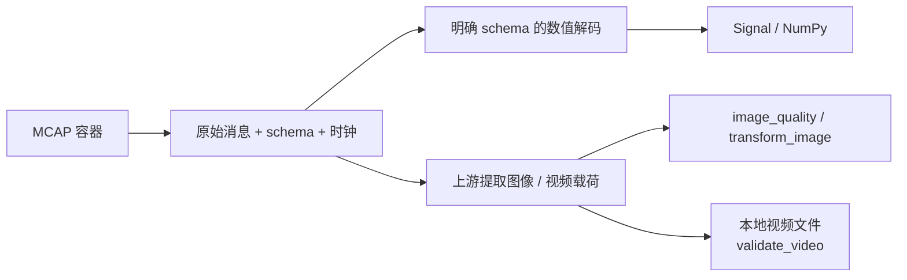

# MCAP、图像与视频

**语言：中文 | [English](../../guides/media.md)**

[文档导航](../README.md) · [Python API](../python.md) · [Rust Decoder](../rust.md)

## 两层解码边界



容器能读，不代表消息格式已被理解。库内置 JSON 数值适配；CDR/Protobuf、压缩图像消息、
视频分包和 packet 时间戳由上游 schema adapter 解释。

## 检查容器与读取 JSON

假设 topic `/state` 的 payload 为 `{"t_ns": 10000000, "position": [0.1, 0.2, 0.3]}`，
且 channel.message_encoding 为 json：

```python
import mcap_ops as ops

path = "/data/example.mcap"  # 替换为自己的只读源文件
inventory = ops.inspect_mcap(
    path,
    filter={"topics": ["/state"]},
    limits={"max_record_bytes": 64*1024*1024, "max_messages": 1_000_000},
    max_gap_ns=100_000_000,
)
signal = ops.read_json_signal(
    path, topic="/state", fields=["/position"], channels=3,
    filter={"topics": ["/state"]},
    timestamp_pointer="/t_ns",
    max_samples=1_000_000,
)
print(signal["values"].shape)  # (N, 3)
```

JSON 指针如 `/pose/position/0`，包含 `/` 或 `~` 的 key 用 RFC 6901 转义。
字段缺失、非数值、通道不符、时间不是 int64 ns 都会失败，不默默跳过。
不指定 timestamp_pointer 时用 log_time，publish_clock=True 时用 publish_time。
filter.publish_clock 是另一项设置，只影响过滤区间的时间基准。

读取保留文件顺序，校验文件中存在的 chunk/data/summary CRC。CRC=0 代表缺失，不是通过。
RawReader 提前停止不等于整文件有效；源在打开期间必须保持不变。

`max_record_bytes` 限制记录大小，`max_messages` 限制扫描消息数；`max_samples` 限制解码结果。
这些不是“内存总量上限”：chunk 解压、时间统计、数值收集会额外占用内存。

## 图像指标与变换

```python
from pathlib import Path
import json
import mcap_ops as ops

raw = Path("frame.jpg").read_bytes()
limits = {"max_width": 4096, "max_height": 4096, "max_pixels": 16_000_000}
quality = ops.image_quality(raw, options=limits)

# crop=[x,y,width,height] 必须在图内；resize 是准确输出尺寸，不自动保留宽高比。
png = bytes(ops.transform_image(
    raw, options_json=json.dumps(limits),
    resize=[224, 224], filter="lanczos3",
))
# png 是新的 PNG 数据；由上游明确决定写入路径，原文件不变。
```

image_quality 的平均亮度/标准差采用 RGB 加权亮度；暗/亮像素比例是阈值统计；
Laplacian 方差可供模糊筛查，但没有跨场景统一合格阈值。`rgb_sha256` 用于比较解码后
尺寸和 RGB 内容，不等同原文件哈希，也不能认定不同视角的图像是否“重复”。

目前仅支持 PNG/JPEG；transform_image 的返回值是 Python `list[int]`，需显式 bytes()。
图像缩放会改变像素，所谓无损 PNG 只描述输出编码，不能把 resize 称作保留原像素。

## 视频完整性

```python
video = ops.validate_video(
    "/data/episode.mp4",
    ffmpeg="ffmpeg", ffprobe="ffprobe", timeout_seconds=120.0,
)
assert video["complete"] and video["decoded"]
print(video["decoded_frames"])
```

底层以参数数组调用外部工具，不拼 shell；只接受本地文件，先 probe，再完整解码首路
视频流。超时、错误诊断、没有帧或没有结束标记会失败。成功只证明解码完成，不证明
曝光/内容质量、不包含音频完整性认证，也没有返回已解码帧数组。

模型帧同步应先保留 frame timestamps，以 align_timestamps 找到帧索引，再交给媒体处理。
不能把平均 FPS 反推为每一帧的准确采集时间。
