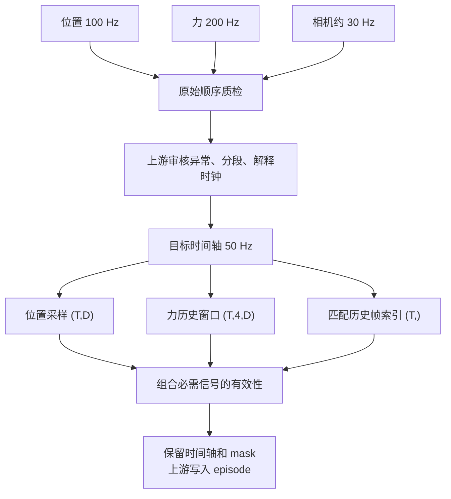

# 多路信号到模型时间步

**语言：中文 | [English](../../guides/pipeline.md)**

[文档导航](../README.md) · [数据契约](../concepts.md) · [Python API](../python.md)

## 先定义信号含义，再选择方法

| 信号 | 一种可用处理方式 | 需要明确的政策 |
| --- | --- | --- |
| 连续位置 | linear；在线观测也可 previous | 单位、最大支撑间隔、是否允许未来 |
| 命令/模式 | previous | 有效期；超龄是否使样本失效 |
| 四元数 | slerp | xyzw、模长要求、坐标系 |
| 力/IMU | 高频历史窗口，或先低通再降采样 | 带宽、延迟、是否要保留冲击 |
| 图像帧 | align_timestamps 返回帧索引 | 最大帧龄；失效不索引 -1 |
| 事件 | 保留事件时间，由上游聚合 | 事件不一定适合连续插值 |

上述是组合方式，不是库隐式执行的规则。所有信号进入同步前应已位于可比较的时钟域；
时间戳数值接近不等于同一个时钟。当前 map_clock 仅 Rust 可用，并且修正参数须显式提供。



## 可运行的最小多信号例子

以下都是生成数组。真实场景把它们替换为解码数据，不要改变单位和维度契约。

```python
import numpy as np
import mcap_ops as ops

ms = 1_000_000
joint_t = np.arange(0, 101, 10, dtype=np.int64) * ms
joint_x = np.column_stack([joint_t / 1e9, joint_t / 1e9 * 2]).astype(np.float64)
force_t = np.arange(0, 101, 5, dtype=np.int64) * ms
force_x = np.ones((len(force_t), 6), dtype=np.float64)
frame_t = np.array([0, 33, 67, 100], dtype=np.int64) * ms

grid = np.asarray(ops.uniform_grid(20*ms, 101*ms, 50, 1, 100), dtype=np.int64)
report = ops.inspect_signal(joint_t, joint_x, {"max_gap_ns": 15*ms})
assert report["total_issues"] == 0

joint = ops.resample(joint_t, joint_x, grid, method="previous", max_age_ns=15*ms)
force = ops.history_windows(
    force_t, force_x, grid,
    np.array([-15, -10, -5, 0], dtype=np.int64) * ms,
    max_age_ns=5*ms,
)
frames = ops.align_timestamps(frame_t, grid, max_past_ns=40*ms)

force_valid = force["valid"].reshape(len(grid), 4).all(axis=1)
step_valid = joint["valid"] & force_valid & frames["valid"]
assert joint["values"].shape == (5, 2)
assert force["values"].shape == (5, 4, 6)
assert step_valid.all()
```

相机帧是索引匹配，不是把压缩图片当作 f64 做插值。先检查 frames.valid，再按 indices
取帧并处理图像；同一帧可能被多个目标时间步使用。

## 质量筛选

Python 示例可以读取 report 作业务决策，但当前没有 Python gate/IntervalSet。
需要完整区间运算时用 Rust 接口，或由上游实现明确的策略。特别注意 issues_truncated，
不能仅凭已截断明细推断所有坏点。

异常不应默认消除：接触、冲击、长时间静止可能是示教目标。业务策略应说明哪些 code
拒绝 episode、哪些只供复核，以及坏区间是否扩展到历史窗口中心。

不要直接 `values[step_valid]` 后重建一条没有断点的时间轴；可保持 mask，或按连续有效段
切分 episode，并保留原始时间和来源。

## 降采样与延迟

resample 本身不抗混叠。对规则高频数据先 `lowpass_taps` + `fir`，在有效支持段内降采样。
例如 200 Hz 降到 50 Hz，低通 cutoff 需低于新 Nyquist 25 Hz，并结合实际信号频带选择。
31 taps 的因果对称 FIR 延迟为 15 个输入步，即 75 ms；centered 版本需要前视 75 ms。
训练观测是否允许这种前视，必须与部署一致，不能仅因为输出时间戳相同就认定同步。

## 上游需要持久化什么

建议将 source 文件身份、topic/字段/单位、时钟来源与变换参数、算子版本与配置、
原始/目标时间轴、valid/status、source_left/right/alpha、分段策略一起存储。
库不提供统一 dataset writer；这些元信息由 LeTools/providers 的输出格式承载。
