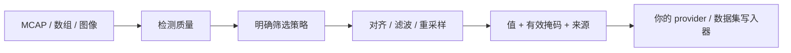

---
hide:
  - navigation
  - toc
---

# 从传感器信号到模型时间步。

**语言：中文 | [English](../index.md)**

MCAP Ops 是带 NumPy 接口的独立 Rust 算子库，用于记录质检和模型输入准备。
每个输出值都应该保留时间、有效性和源样本支持信息。

[开始教程](tutorials/first-pipeline.md){ .md-button .md-button--primary }
[查询 API](reference/index.md){ .md-button }

- **Tutorials · 教程**

    理解为什么要分开检测、筛选和变换，从源码安装，再用生成信号搭建处理流程。

    [查看学习路线](tutorials/index.md)

- **Documentation · 接口手册**

    查询全部 14 个 Python 算子的签名、选项、输出、错误和示例，
    以及 Rust 类型、方法和解码器抽象。

    [浏览接口手册](reference/index.md)

- **RSI · 迭代优化**

    跟随性能剖析、正确性验证、benchmark 和验收工作流，
    查看包括失败尝试在内的 380 条历史决策。

    [阅读工作手册](../../RSI/zh/README.md)

## 从原始记录到模型时间步

**当前接口版本：0.1.0。** 从源码安装，尚未发布到 PyPI 或 crates.io。
core 可以直接处理数组，不依赖 MCAP、ROS 或机器人 schema。
CDR/Protobuf 解码、数据集写入、任务调度和时钟估计由上游负责。
参见[安装说明和已验证平台](getting-started.md)。

中英文指南覆盖相同接口；编译器生成的 Rust 签名和历史测量证据共用一份。
