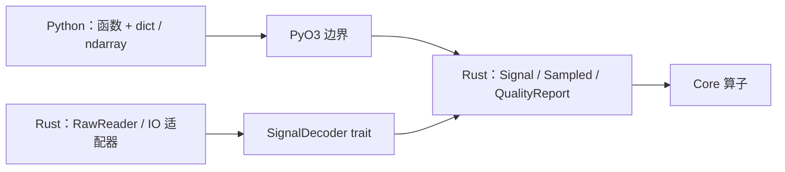

# Documentation · 接口手册

**语言：中文 | [English](../../reference/index.md)**

版本 **0.1.0**。这里用于按接口查询；按步骤学习请阅读 [Tutorials](../tutorials/index.md)。

## Python 算子

使用 `import mcap_ops as ops`。每个接口页都包含签名、参数和默认值表、
返回契约、失败行为以及完整示例。

| 分类 | 算子 | 结果 |
| --- | --- | --- |
| 质检 | [inspect_signal](python/inspect_signal.md) | 时间、通道统计与问题明细 |
| 时间 | [uniform_grid](python/uniform_grid.md) | 有理数频率的纳秒网格 |
| 时间 | [align_timestamps](python/align_timestamps.md) | 匹配索引、偏移与有效性 |
| 采样 | [resample](python/resample.md) | 数值、有效性、源支持 |
| 采样 | [history_windows](python/history_windows.md) | 历史窗口数值与支持 |
| 滤波 | [ema](python/ema.md) | 感知时间的因果平滑 |
| 滤波 | [lowpass_taps](python/lowpass_taps.md) | FIR 系数 |
| 滤波 | [fir](python/fir.md) | 滤波数值与延迟元信息 |
| 滤波 | [unwrap_angles](python/unwrap_angles.md) | 周期数值展开 |
| MCAP | [inspect_mcap](python/inspect_mcap.md) | 容器/通道质量报告 |
| MCAP | [read_json_signal](python/read_json_signal.md) | 显式解码的数值信号 |
| 图像 | [image_quality](python/image_quality.md) | 曝光、清晰度、RGB hash |
| 图像 | [transform_image](python/transform_image.md) | 裁剪/缩放后的 PNG |
| 视频 | [validate_video](python/validate_video.md) | 首个视频流完整解码报告 |

`ops.__version__` 是字符串；私有 `_native` 符号不属于公共 API。

## 共同输入契约

| 输入 | 契约 |
| --- | --- |
| timestamps、source、target、centers、offsets | 连续一维 `numpy.int64`，纳秒 |
| values | `numpy.float64`，`(N,)` 或 `(N,D)`；允许非连续和逆序视图 |
| FIR 系数 | 连续一维 `numpy.float64` |
| 数值所有权 | 输入复制到 Rust 自有快照；输出不与输入共享内存 |
| 执行 | 当前调用仍持有 GIL |
| 配置 | wrapper 使用字典；`transform_image.options_json` 使用 JSON 字符串 |
| 错误 | core 验证 -> ValueError；core 算术溢出 -> OverflowError；IO 错误 -> ValueError；参数转换也可能抛出 TypeError/OverflowError |

`N` 为源样本数，`D` 为通道数，`M` 为目标步数，`T` 为窗口中心数，
`W` 为每窗口偏移数。不隐式转换 dtype、单位、坐标系、时钟或 schema。
采样/滤波要求有序时间；检测接受原始顺序以发现问题。

## 类型、类与抽象

Python 返回字典、列表和 NumPy 数组，没有导出 `Signal` 或 `IntervalSet` Python 类。
[类型指南](types.md) 将这些结果映射到 Rust 结构体，并解释掩码、状态和配置。

[Rust 接口索引](rust.md) 将全部公共类型和函数链接到编译器生成的文档，
可查询字段、方法、trait 实现和源码，涵盖仅 Rust 可用的质量 gate、
区间集合、时钟映射、读取器和 `SignalDecoder` 扩展点。

时钟语义与来源信息见[数据契约](../concepts.md)；
全部签名单页查询见 [Python 速查](../python.md)。
