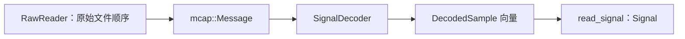

# 类型与抽象

**语言：中文 | [English](../../reference/types.md)**

这些名称属于 Rust 类型。Python 使用普通字典、数组和列表表达相应数据，
没有将它们包装成类。精确字段和方法见 [Rust 接口索引](rust.md)。

## Signal 与 SignalSpec

| 类型 | 用途 / 契约 |
| --- | --- |
| `Signal` | 自有 `Vec<i64>` 纳秒时间、行优先 `Vec<f64>` 数值、正通道数 |
| `Signal::new` | 验证 `timestamps.len() * channels == values.len()`，不要求时间有序或数值有限 |
| `Signal::require_ordered` | 显式验证时间严格递增 |
| `Signal::timestamps / values / row` | 借用切片；`row(index)` 要求索引在范围内 |
| `Signal::len / is_empty / channels` | 不复制数据即可查询 shape |
| `Signal::into_parts` | 消耗 Signal，转移时间、数值缓冲区与通道数 |
| `SignalSpec` | name、kind、channels、unit、frame、timestamp_source、required |
| `SignalKind` | Continuous、QuaternionXyzw、Command、Discrete、Event |

`SignalSpec` 是描述性元信息，不是自动分派或转换引擎。
Python Signal 字典包含 `timestamps: int64[N]`、`values: float64[N,D]`、
`channels: int`，元信息由上游保存。

## 质量报告与策略

| 类型 | 字段 / 含义 |
| --- | --- |
| `TimeStats` | samples、first_ns、last_ns、reversals、duplicates、gaps、positive_interval_min/median/p95/max_ns、estimated_hz |
| `ChannelStats` | finite、nonfinite、min、max、mean、std、statistics_overflow |
| `Issue` | code、channel、start_index、end_index_exclusive、start_ns、last_ns、metric、threshold |
| `QualityReport` | time、channels、issues、total_issues、issues_truncated、dynamic_checks_completed、flagged_sample_count |
| `QualityConfig` | 检测阈值和资源上限；[完整默认值](python/inspect_signal.md) |
| `GatePolicy` | reject_codes、[0,1] 内的 max_flagged_fraction、min_samples |
| `GateDecision` | passed、reasons、flagged_fraction |

无法计算的统计量为 `None`。时间问题的 `Issue.channel` 可能为 `None`。
Issue 没有 severity 字段；索引区间为半开区间，但 `last_ns` 是包含端点的最后源时间。

`IssueCode` 序列化为 `non_finite`、`below_range`、`above_range`、
`clock_reversal`、`duplicate_time`、`gap`、`rate`、`acceleration`、
`spike` 或 `flatline`。即使明细被截断，`gate` 仍使用完整的内部标记/代码。
Python 报告不包含 `flagged_samples` 和 `all_codes`；
请使用完整计数或显式上游策略，不能从部分明细重建完整掩码。

## SampleOptions、Sampled、Windowed 与 Status

`SampleOptions` 含 method、max_gap_ns、max_age_ns、allow_future。
`Method` 为 Previous、Nearest、Linear 或 Slerp。
Rust 中显式提供限制，Python 中两个采样限制默认都为零。

| 字段 | Python Sampled | Python Windowed |
| --- | --- | --- |
| timestamps | int64 `(M,)` | int64 `(T,W)` |
| values | float64 `(M,D)` | float64 `(T,W,D)` |
| channels | int | int |
| centers、offsets | 无 | int64 `(T,)`、`(W,)` |
| status | uint8 `(M,)` | uint8 `(T*W,)` |
| valid | bool `(M,)` | bool `(T*W,)` |
| source_left/right | int64 `(M,)` | int64 `(T*W,)` |
| alpha | float64 `(M,)` | float64 `(T*W,)` |
| uses_future | bool `(M,)` | bool `(T*W,)` |

Rust 使用扁平向量和 `Windowed.samples`，由 centers/offsets 描述 shape。
源索引指向传入 Signal 中的样本，不是原始文件消息 ID。
单点支持重复相同索引，alpha=0。有效性针对整行，而非单个通道。

| 代码 | Rust Status | 含义 |
| ---: | --- | --- |
| 0 | Valid | 支持充分且整行有限 |
| 1 | Missing | 缺少必要支持 |
| 2 | Gap | 两点支持间隔超过限制 |
| 3 | Stale | 单点支持超过年龄限制 |
| 4 | NonFinite | 输入/输出非有限 |
| 5 | Future | 禁止未来支持 |
| 6 | InvalidQuaternion | 四元数不满足范数要求 |

无效输出的值/alpha 为 NaN，源索引为 -1。请查看 status，
不能仅凭 NaN 判断失败原因。`valid` 严格等于 `status == 0`。

## TimeAlignment 与 Filtered

`TimeAlignment` 含 indices、offsets_ns（源减目标时间）、valid，
只选样本，不改变数值。

`Filtered` 含 Signal、valid、mode、lookahead_samples、group_delay_samples。
Python 将 Signal 字段平铺到结果字典，valid 仍是 **list**，不是 ndarray。
`FilterMode` 为 Causal/Centered。无法表示为常数的群延迟为 `None`；
报告延迟为零不代表不需要前视。

## Interval 与 IntervalSet

`Interval { start_ns, end_ns }` 表示 `[start,end)`。
`IntervalSet::new` 拒绝空/倒置区间、排序并合并重叠/相邻区间。
`intervals` 借用规范化区间；`contains`、`mask`、`intersection`、
`difference` 进行查询/选择而不改变源数据。`mask` 接受无序时间。
`affected_centers(history_ns,future_ns)` 将坏区间扩展到上下文会碰到它的中心时间，
并检查溢出。这些接口仅限 Rust。

## 读取器与解码器抽象

- `RawReader::open(path, MessageFilter, ReadLimits)` 返回可失败的迭代器；
  提前终止不等于验证完整文件。
- `MessageFilter` 和 `ReadLimits` 默认值见
  [inspect_mcap](python/inspect_mcap.md)，用于扫描选择与上限。
- `SignalDecoder::channels()` 声明维度；
  `decode(&Message) -> Result<Vec<DecodedSample>>` 提供样本。
- `DecodedSample` 含 timestamp_ns 和 values；零个样本代表无关消息，
  多个样本可表示消息内批次。
- `JsonSignalSpec` 含 topic、fields、channels、timestamp_pointer、
  publish_clock，为显式 JSON 字段实现 `SignalDecoder`。
- `McapReport` / `ChannelReport`、`ImageOptions` / `ImageQuality`、
  `VideoValidation` 见相应算子页面。

解码器负责 schema、单位和时钟解释，core 不猜测这些含义。
参见[扩展示例](../rust.md)。

## 错误

core `Error` 为 `Invalid(String)` 和 `Overflow`。
IO `Error` 保留 IO、MCAP、Core、Json、Image 错误，并增加 Invalid；
`Result<T>` 是各 crate 的结果别名。
Python 在绑定边界映射错误，见[共同契约](index.md)。
