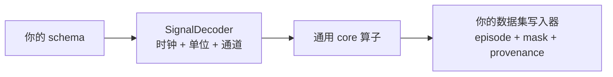

# 最佳实践

**语言：中文 | [English](../../tutorials/best-practices.md)**

## 数据契约与信号一起保存

| 决策 | 显式记录 | 避免的问题 |
| --- | --- | --- |
| 时间 | int64 ns、源时钟、校正参数 | 混用 log、publish、payload 时钟 |
| 数值 | 通道、单位、坐标系、四元数顺序 | 数值合理但物理含义错误 |
| 有效性 | status、mask、gap 和 age 限制 | 把缺失或过期样本当成观测 |
| 因果性 | allow_future、lookahead、group delay | 训练使用部署时无法获得的观测 |
| 筛选 | gate 阈值、区间与 episode 策略 | 拼接剩余行时隐藏中间缺口 |
| 来源 | 源标识、字段、版本、配置、支持索引 | 无法复现输出 |

本库不会根据 topic 名猜测这些决策。

## 根据信号选择表示

- 命令和模式：用 `previous`，并设置有意义的最大有效年龄。
- 连续观测：因果特征用 `previous`；允许未来支持时才用 `linear`。
- 方向：用四通道 xyzw `slerp`，明确坐标系和范数要求。
- 图像：先对齐时间、检查索引有效性，再选择完整帧。
- 力和 IMU：冲击重要时保留高频历史；降采样时设计抗混叠滤波并考虑延迟。

`resample` 不会自动抗混叠。对称 31-tap 因果 FIR 有 15 个输入时间步的群延迟；
居中模式需要未来上下文。仅让输出时间戳相同并不能消除这些影响。

## 按有边界、有语义的单元处理

先检查记录，再按 episode 或有效连续段处理。根据负载设置读取上限和
`max_samples`。record 上限不是 RSS 上限，图像变换会分配解码像素。
视频验证会完整解码第一个视频流，仅读取容器元数据不能提供同样的验证。

Python 数组会复制到 Rust 自有快照中，调用期间仍持有 GIL。
上游使用进程并行前应测量内存与 IO 争用，不要假设 Python 线程池会让算子并行。

## 在边界上扩展

schema 解码放在 provider 或 IO 层，数据集格式和任务调度放在上游。
只有不依赖特定机器人或文件格式、对数组本身有意义的操作才适合进入 core。

先通过公共接口正确性测试，再 benchmark。性能工作遵循
[RSI 手册](../../../RSI/zh/README.md)；历史加速结果不能代表你的数据吞吐。
