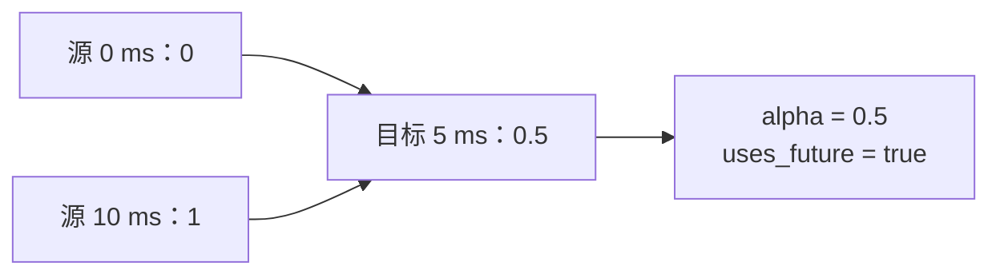

# 第一个处理流程

**语言：中文 | [English](../../tutorials/first-pipeline.md)**

完成[安装](../getting-started.md)后运行以下完整示例，
把 100 Hz 的标量信号变成 200 Hz 信号。

```python
import numpy as np
import mcap_ops as ops

t = np.array([0, 10, 20], dtype=np.int64) * 1_000_000
x = np.array([0.0, 1.0, 2.0], dtype=np.float64)
report = ops.inspect_signal(t, x, {"max_gap_ns": 15_000_000})
assert report["total_issues"] == 0

grid = np.asarray(ops.uniform_grid(0, 25_000_000, 200, 1, 100), dtype=np.int64)
sampled = ops.resample(
    t, x, grid, method="linear",
    max_gap_ns=15_000_000, allow_future=True,
)
np.testing.assert_allclose(sampled["values"][:, 0], [0, 0.5, 1, 1.5, 2])
assert sampled["valid"].all()
assert sampled["source_left"].tolist() == [0, 0, 1, 1, 2]
assert sampled["source_right"].tolist() == [0, 1, 1, 2, 2]
print(sampled["values"][:, 0])
```

输出：`[0.  0.5 1.  1.5 2. ]`。

## 不只看数值，还要看支持样本

| 目标时间 | 数值 | 源索引 | 使用未来 |
| --- | ---: | --- | --- |
| 0 ms | 0 | 0, 0 | false |
| 5 ms | 0.5 | 0, 1 | true |
| 10 ms | 1 | 1, 1 | false |
| 15 ms | 1.5 | 1, 2 | true |
| 20 ms | 2 | 2, 2 | false |



5 ms 的输出需要 10 ms 的观测，这要求你的特征策略允许未来样本。
如果需要因果观测，将参数改成 `method="previous", max_age_ns=15_000_000`，
保持默认 `allow_future=False`，结果就是 `[0, 0, 1, 1, 2]`。

## 保留失败信息

age/gap 容差为零表示严格限制，不是无限容差。
支持样本不足时会返回无效掩码和 NaN。
始终保留目标时间与掩码，不要把失败的样本悄悄填成零。

下一步：[质检与筛选](quality.md)，或查询
[resample](../reference/python/resample.md)。
