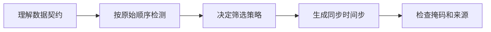

# Tutorials · 教程

**语言：中文 | [English](../../tutorials/index.md)**

从这里学习如何使用算子库。如果已经知道函数名，直接进入[接口手册](../reference/index.md)。

| 步骤 | 阅读 | 学完能做什么 |
| --- | --- | --- |
| 1 | [设计理念](../architecture.md) | 分清业务策略和通用数值算子的职责 |
| 2 | [安装](../getting-started.md) | 在隔离环境中构建原生扩展 |
| 3 | [第一个处理流程](first-pipeline.md) | 检测并重采样信号，理解输出来自哪些样本 |
| 4 | [质检与筛选](quality.md) | 将质检证据变成明确的接收策略 |
| 5 | [同步模型时间步](../guides/pipeline.md) | 组合位置、力历史窗口和图像帧索引 |
| 6 | [MCAP 与媒体](../guides/media.md) | 提取 JSON 信号，检查图像，验证视频解码 |
| 7 | [最佳实践](best-practices.md) | 在上游保留时间、因果性、资源限制和可复现信息 |

示例使用生成的数据，不需要机器人服务或下载数据集。
数值例子需要 NumPy 和已安装的 `mcap_ops`；
媒体例子按需使用 Pillow、Python `mcap` 包和 FFmpeg。

导航参考了 [PyTorch](https://docs.pytorch.org/tutorials/) 和
[Polars](https://docs.pola.rs/user-guide/) 将学习教程与接口查询分开的方式。
接口页按签名、参数、返回值、错误、示例组织；
MCAP Ops 的时钟与质量契约以本库实现为准，不能直接套用张量库的习惯。
