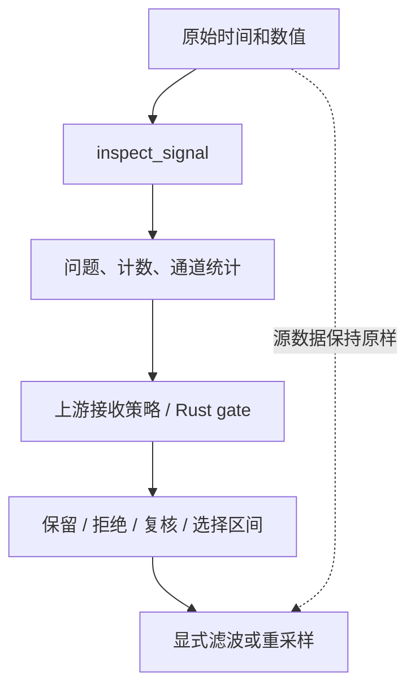

# 先检测，再决定

**语言：中文 | [English](../../tutorials/quality.md)**

检测输出证据，应用决定这段记录是否有用。
力的导数很大可能代表接触事件，长时间静止也可能是正确任务行为。

```python
import numpy as np
import mcap_ops as ops

t = np.arange(4, dtype=np.int64) * 10_000_000
x = np.array([0.0, 0.2, 8.0, 0.3], dtype=np.float64)
report = ops.inspect_signal(t, x, {"lower": [-1.0], "upper": [1.0]})
assert report["total_issues"] == 1
issue = report["issues"][0]
assert issue["code"] == "above_range"
assert (issue["start_index"], issue["end_index_exclusive"]) == (2, 3)

# This application rejects any flagged sample; the library does not decide.
accepted = report["flagged_sample_count"] == 0
assert not accepted
np.testing.assert_array_equal(x, [0.0, 0.2, 8.0, 0.3])
```

## 三种不同操作



1. **检测：** 在排序、去重前检查原始文件顺序，避免抹掉时钟回退证据。
2. **筛选：** 使用显式上游策略或 Rust `gate` / `IntervalSet`；
   后两者目前没有 Python 接口。
3. **变换：** 在明确策略下滤波、插值；发现问题不会自动修改信号。

## 有上限的明细不等于完整掩码

`max_issues` 只限制保存的问题明细，不限制 `total_issues` 和
`flagged_sample_count`。如果 `issues_truncated` 为真，就不能根据问题列表重建全部坏样本。
Rust 内部保留完整标记供 gate 使用，Python 报告没有导出这些内部数组。

动态检查要求时间有序。应检查 `dynamic_checks_completed`：
有时钟回退的报告不代表速率、加速度和窗口检查已全部完成。
`Issue.last_ns` 是包含端点的源时间，而 `IntervalSet` 使用 `[start,end)` 半开区间。
转换前需要决定样本覆盖范围，并处理溢出。

下一步：[同步模型时间步](../guides/pipeline.md)。
参考：[inspect_signal](../reference/python/inspect_signal.md)、
[质量类型](../reference/types.md)、[Rust 筛选接口](../reference/rust.md)。
